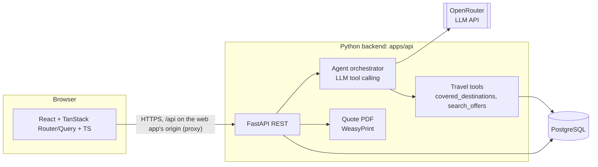
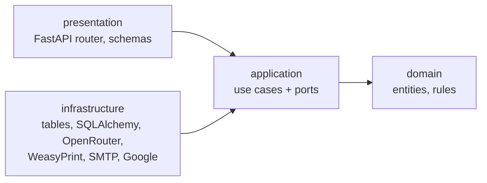
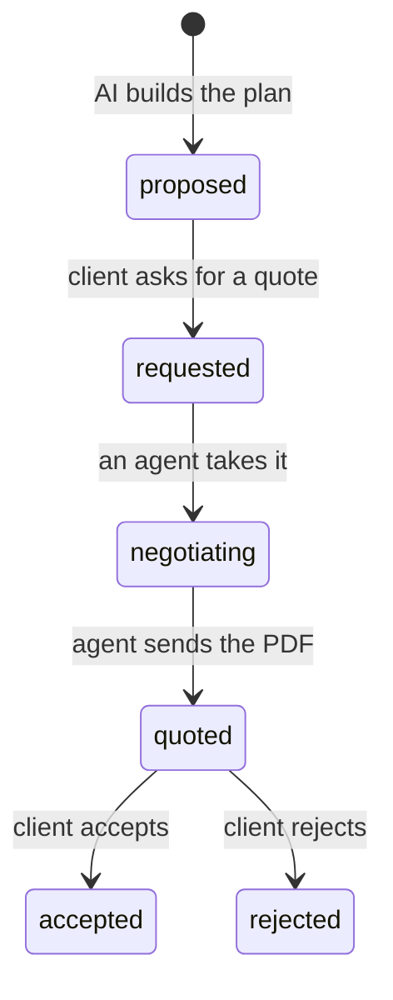

# Novoya architecture

Novoya is a travel agency with an AI assistant. A client signs in with Google or with an email and password, describes the trip they want, refines it in a preference panel, and gets a proposed plan built only from partner offers. A human travel agent from the agency then negotiates the prices with the partners and sends the client a PDF quote with the total price. The client accepts or rejects it.

Novoya only sells what its partners (prestataires) offer: hotels, guides, transport and activities in the destinations they cover. If no partner covers a destination, Novoya cannot plan a trip there and says so.

Two decisions shape this version:

- **No import of the client's past trips.** Reading Gmail, Google Docs or Instagram to find past trips was refused by the school as not GDPR compliant. Novoya only stores what the client types into it.
- **No fixed prices.** Partner prices are negotiated for each trip. The AI never shows a price. Only the quote written by a human agent has one.

This document is the starting proposal. Change it by pull request, like code.

## 1. User flow

### Client

1. The client signs in with Google or with an email and password.
   - **Google**: the first sign-in creates the account. We only ask for `openid email profile`.
   - **Email and password**: the client signs up with a form, then clicks the link in a verification email. They cannot sign in until the email is verified. They can reset a forgotten password by email.
   - A new account always has the `client` role. If someone signs up with a password and later signs in with Google using the same email, they get the same account.
2. The client types what they want ("a calm week by the sea in May").
3. The AI checks coverage: is there at least one listed offer (an active offer of an active partner) at that destination? If not (for example Japan with no partner there), it says so and suggests covered destinations close to the wish. The flow stops here.
4. The AI opens a preference panel: sections, each with tags to pick (style, rhythm, accommodation, activities, food, transport...). The tags come from the partner offers at that destination, so the client can only pick what we can deliver.
5. The last step of the panel asks for the maximum budget, the number of travellers and the dates.
6. The AI builds a proposed plan from partner offers, day by day, **without prices**. If the client picked no tags, it builds the plan from the wish text, budget and travellers, starting with the offers partners mark as `featured`.
7. The client asks the agency for a quote on that plan.
8. When the quote is ready, the client gets an email with a button to log in. They open the quote PDF in their account and accept or reject it.

### Travel agent (agency staff)

1. The agent signs in like a client, with Google or with an email and password. An admin has given their account the `agent` role.
2. The agent sees the list of plans waiting for a quote, with the client's wish, budget, travellers and dates.
3. The agent takes a plan and negotiates with each partner outside Novoya (phone, email).
4. For each plan item, the agent enters the negotiated price. They can remove an item a partner cannot deliver.
5. The agent generates the quote: Novoya computes the total, renders the PDF, makes it visible to the client and emails them.
6. The agent sees when the client accepts or rejects.

Admins manage partners, offers, extras and reviews in the admin pages.

### Admin

1. The admin signs in like everyone else. Their account has the `admin` or `super_admin` role, which can do everything an agent can.
2. The admin lists the users, changes their role and disables or enables their account. A plain admin manages clients and agents; only a super admin gives the `admin` role and acts on admins, and super admins are managed with the `grant-role` command only: the API never gives or takes that role, nor disables a super admin ([ADR 0015](adr/0015-super-admin-role.md)). Nobody changes their own role or account, and there is always at least one active super admin.
3. `agent`, `admin` and `super_admin` are only given to accounts with a verified email. Every role change is logged.

Super admins are named and demoted with a server command only (`grant-role`).

## 2. System overview



| Part | Tech | Job |
|---|---|---|
| `apps/web` | React, TypeScript, Vite, TanStack Router, TanStack Query, TanStack Form | Client pages (wish, panel, plan, quote) and agent pages (quote queue, pricing) and admin pages (users, partners and offers, extras, reviews, activity) |
| `apps/api` | Python 3.12, FastAPI, Pydantic v2, SQLAlchemy 2, Alembic | Modular monolith with Clean Architecture: accounts, catalog, wishes, planning and quoting modules, each with domain, use cases, adapters and REST endpoints |
| Database | PostgreSQL | Users, partners and offers, wishes, plans, quotes |
| LLM | OpenRouter, called with the OpenAI Python SDK | Check coverage, build the panel, write the plan |

There is no worker, no queue and no MCP server in this version. Nothing runs in the background: every AI call happens during a request and takes a few seconds.

### Backend: modules + Clean Architecture

The backend is a modular monolith: one application and one database, split by business module, with the same Clean Architecture layers inside every module.

| Module | Owns |
|---|---|
| `accounts` | Users, sign-in with Google or email and password, sessions, client, agent and admin roles, language, deleting an account |
| `catalog` | Partners, offers, covered destinations |
| `wishes` | The wish, the coverage check, the preference panel |
| `planning` | The plan built from offers, its status machine, the agent's negotiation |
| `quoting` | The quote: total, validity, PDF, email, accept or reject |
| `dashboard` | The admin home's key numbers. No table: each module counts its own rows |
| `shared` | Domain errors, common value objects, database session, LLM client |

Inside each module, source code dependencies only point inward:



- **Domain**: entities and business rules, such as the plan's allowed status changes. Pure Python.
- **Application**: one use case per user action and the ports (interfaces) it needs.
- **Infrastructure**: adapters that implement the ports with real tools, and the module's tables.
- **Presentation**: the module's FastAPI router and schemas, and its composition root that plugs adapters into use cases.

Modules talk to each other only through a small `public.py`. A use case that needs another module declares a port, and an adapter in its infrastructure calls the other module's `public.py`. So each module can change its internals freely, and one developer can own a module.

A test (`tests/test_architecture.py`) reads every import and fails in CI if a layer or a module breaks these rules. The full explanation is in [BACKEND.md](BACKEND.md).

### Travel tools, in-process

The agent orchestrator gives the LLM two tools through the `tools` parameter (tool calling). They are plain Python functions in the `planning` module (`infrastructure/llm/tools.py`) that read the catalog through `catalog.public`:

- `covered_destinations()`: the countries and cities with at least one listed offer (an active offer of an active partner).
- `search_offers(country, city, tags, persons, start_date, end_date)`: the active offers of active partners at that destination that fit the group size and the whole trip. `city` and `tags` are optional. With tags, an offer needs at least one of them, and offers matching more tags come first, then `featured` ones. There is no budget argument: offers have no price.
When the LLM asks for a tool, the orchestrator runs the function and sends the result back. The LLM never touches the database directly.

- The model chooses the arguments, so each tool checks them. Bad arguments, dates in the wrong order or an uncovered destination give the model an error it can act on, for example "call covered_destinations".
- `search_offers` returns at most 20 offers, each with its `offer_id`, and never the partner's name or contact: the model and its provider are third parties.

### The LLM: OpenRouter

The school asks for a model served through OpenRouter. OpenRouter's API is compatible with OpenAI's, so the backend uses the official `openai` Python SDK with a different base URL:

```python
client = AsyncOpenAI(base_url="https://openrouter.ai/api/v1", api_key=settings.openrouter_api_key)
```

- The model is a setting, `NOVOYA_LLM_MODEL`, so we can switch models without changing code. It must support tool calling (OpenRouter lists this as `tools` in the model's supported parameters).
- The API key is `NOVOYA_OPENROUTER_API_KEY`. It stays on the server and never reaches the browser.
- Not every model follows a JSON schema reliably, so the backend validates every answer with Pydantic, retries once, then falls back (see section 3).
- The key is shared by every client. When OpenRouter answers `429`, model calls pause for its `Retry-After` (5 minutes without one, an hour at most), in memory for the whole process. During the pause each step goes straight to its fallback instead of waiting for every model to fail. Other errors still try the next model. The SDK does not retry: the orchestrator falls back itself.
- Tests use a fake client. CI makes no live LLM calls.

## 3. The dynamic panel

The LLM does not write UI. It returns JSON that matches a Pydantic schema, and the frontend renders it with generic components.

```json
{
  "sections": [
    {
      "id": "style",
      "title": "Travel style",
      "multi": true,
      "tags": [
        { "id": "beach", "label": "Beach", "preselected": true },
        { "id": "culture", "label": "Culture" }
      ]
    }
  ],
  "ask_budget": true,
  "ask_persons": true,
  "ask_dates": true
}
```

The backend validates this JSON. If validation fails, it retries once, then falls back to a panel built directly from the tags of the offers at that destination. The frontend has one `<PanelSection>` component and one `<TagPicker>`; it never needs to know which sections exist.

## 4. Partners, coverage and the no-preference case

Novoya works with a limited list of partners. The `partners` and `offers` tables are the catalog, and the travel tools are the AI's only way to read it. The catalog comes from the client's DÉTOUR export, imported with `python -m novoya_api.catalog.infrastructure.detour --source detour.sqlite` ([ADR 0014](adr/0014-indicative-prices-and-detour-import.md)): partners, offers, publishable reviews and extras. DÉTOUR owns what it exports: the agency changes it there, and in Novoya an admin only hides a row or features an offer. Countries are stored in English; a wish may name them in English or French.

| Case | What happens |
|---|---|
| Destination not covered | No panel. The AI explains it and suggests covered destinations. The wish is saved with status `not_covered`, so the team sees which destinations clients ask for and which partners to look for next. |
| Covered, tags picked | The AI builds the plan from offers that match the tags, travellers and dates. |
| Covered, no tags picked | The AI builds the plan from the wish text, budget and travellers, starting with `featured` offers. The plan is marked `based_on_preferences: false` so the UI can say so. |

The AI may only use offers returned by `search_offers`. The backend checks that every item in a plan points to a real, active `offer_id` before saving it.

An offer may carry the partner's unit price per person. It is shown only on the offer page, as indicative (`GET /offers/{id}`): plans and quotes use the prices the agent negotiates ([ADR 0014](adr/0014-indicative-prices-and-detour-import.md)). The client's budget is saved on the wish and shown to the human agent, who negotiates within it.

When asking for a quote, the client can add extras (a quiet room, an extra bag, a private guide): `included` ones cost nothing, a `supplement` is counted once at its amount then, and the agent prices `on_quote` ones before the quote can be sent.

## 5. From plan to quote

A plan moves through these statuses:



- **proposed**: the client sees the plan, with no price.
- **requested**: the plan is in the agents' queue.
- **negotiating**: one agent owns it (`assigned_agent_id`). They enter a negotiated price on each item.
- **quoted**: every remaining item has a price. The agent clicked "Send quote". The backend computes the total, saves a `quotes` row and renders the PDF.
- **accepted** or **rejected**: the client's final answer. A rejected client can start a new wish.

### The quote PDF

The PDF is an HTML template (Jinja2) rendered with WeasyPrint. The client reads it in their account.

When the quote is sent, the client gets an email in the quote's language (English or French), after the quote is saved. It says their offer is available in their account and has one button, "Log in to see my quote", that opens the quote after sign-in. The email holds no PDF, prices or partner names. It is sent over SMTP (`NOVOYA_SMTP_*` settings); locally, Mailpit in docker-compose catches it. If it does not go out, the quote stays sent, the response says `email_sent: false`, and the agent who sent it (or an admin) can send it again.

| Shown on the PDF | Not shown |
|---|---|
| Quote number, issue date, valid until (7 days after sending) | Partner names: the client sees what is booked, not who provides it |
| Client, destination, dates, travellers, the agent's contact | A separate agency fee line: any margin is already inside the item prices |
| The wish text and the tags picked | |
| The plan day by day: each item, quantity and price | |
| The total and, under it, the client's maximum budget | |
| How to accept or reject, and what is not included (flights, other meals, drinks, tips, insurance) | |

The PDF exists in English and French, in the client's language (`users.locale`). Prices are in euros.

## 6. Data model (first version)

| Table | Main columns |
|---|---|
| `users` | id, email, name, first_name, last_name, role (`client`, `agent`, `admin`), locale (`en`, `fr`), status (`active`, `disabled`), email_verified_at, created_at, updated_at |
| `oauth_identities` | id, user_id, provider (`google`), subject (Google's `sub`), created_at, last_login_at |
| `password_credentials` | user_id, password_hash (Argon2id), updated_at |
| `sessions` | id, user_id, token_hash, created_at, last_seen_at, idle_expires_at, absolute_expires_at, revoked_at, user_agent |
| `one_time_tokens` | id, user_id, purpose (`email_verification`, `password_reset`), token_hash, expires_at, used_at, created_at |
| `oauth_states` | state_hash, provider, code_verifier, nonce, redirect_to, expires_at |
| `role_changes` | id, user_id, old_role, new_role, source (`admin_api`, `cmd_grant_role`), changed_by, changed_at |
| `partners` | id, name, kind (hotel, guide, transport, activity, agency), country, city, contact_email, contact_phone (optional), active, hidden (the agent's switch, kept by the import), source (`detour` when imported), created_at |
| `offers` | id, partner_id, kind, title, description, country, city, min_persons, max_persons, available_from, available_to, tags, featured, active, hidden, price_eur and price_unit (indicative, per person per night, trip or activity), opening_months, conditions, restrictions, cancellation, confirmation_delay_hours |
| `reviews` | id, country, city, rating (1 to 5), reviewed_on, text, author ("First name I." or "Voyageur anonyme"), hidden, imported_at. Only published, consented reviews |
| `extras` | id, category, label, description, pricing (`included`, `supplement`, `on_quote`), supplement_eur, unit, constraints, active, hidden |
| `wishes` | id, user_id, text, destination_country, destination_city, status (`draft`, `not_covered`, `panel_shown`, `answered`, `planned`), panel_json (the panel we showed), selected_tags (what the client clicked, for example `[{"section": "style", "tag": "beach"}]`), budget_max, currency, persons, start_date, end_date, created_at, updated_at |
| `plans` | id, wish_id, status (`proposed`, `requested`, `negotiating`, `quoted`, `accepted`, `rejected`), based_on_preferences, summary, assigned_agent_id, created_at, updated_at |
| `plan_items` | id, plan_id, offer_id, day, quantity, note, negotiated_price (empty until the agent fills it), removed |
| `plan_extras` | plan_id, extra_id, pricing, price_eur (the supplement when requested, or the agent's price for `on_quote`), label and unit (copied when requested), confirmed (the agent set its price; a supplement per person, night or day needs it before the quote) |
| `quotes` | id, number (`NV-YYYYMMDD-XXXXXX`), plan_id (one quote per plan), client_id, agent_id, total_price, currency (`EUR`), locale, sent_at, valid_until (sent_at + 7 days; the quote stays open to the end of that day in Paris), pdf (the file's bytes: the demo host wipes its disk, [ADR 0013](adr/0013-host-the-demo-on-render.md)), answer (`accepted`, `rejected`) and decided_at (both set together when the client answers), client_comment |

`wishes` holds the whole request: the text, the panel we showed, the tags the client clicked, the budget, the number of travellers and the dates. `panel_json` and `selected_tags` are JSONB columns.

Roles live in the database (`users.role`). A new account is `client`, and signing in never changes a role. Only an admin changes it, through `/admin/users`, and only a super admin when the admin roles are involved; each change is written to `role_changes`. The first super admin is set with the `grant-role` command.

An account can have Google, a password, or both: `oauth_identities` and `password_credentials` hold one sign-in method each. Sessions are opaque tokens stored hashed in `sessions`, so signing out, resetting a password or changing a role takes effect at the next request. Sessions expire after 7 days without use and 30 days at most.

The browser calls the API at `/api` on the web app's own origin, through a proxy that strips the prefix (Vite locally, the Render static site's rewrite for the demo, [ADR 0013](adr/0013-host-the-demo-on-render.md)). The session cookie is then always first-party, wherever the API is hosted ([ADR 0011](adr/0011-same-origin-api-proxy.md)).

## 7. API (first version)

Client:

| Method | Path | What it does |
|---|---|---|
| GET | `/auth/google/login` | Start Google sign-in |
| GET | `/auth/google/callback` | Create, link or load the user, set a session cookie |
| POST | `/auth/register` | Sign up with an email and password. Sends the verification email |
| POST | `/auth/email/verify` | Verify the email with the token from the link |
| POST | `/auth/email/verify/resend` | Send the verification email again |
| POST | `/auth/login` | Sign in with an email and password, set a session cookie |
| POST | `/auth/password/forgot` | Send a password reset link |
| POST | `/auth/password/reset` | Set a new password with the token from the link. Signs out every session |
| POST | `/auth/password/change` | Change the password. Signs out the other sessions |
| POST | `/auth/logout` | Sign out |
| POST | `/auth/logout-all` | Sign out on every device |
| GET | `/me` | The signed-in user, their role, language and sign-in methods |
| PATCH | `/me` | Change the signed-in user's language (`{"locale": "en"}` or `"fr"`); answers like `GET /me` |
| GET | `/destinations` | Destinations with at least one listed offer (active offer of an active partner) |
| GET | `/reviews?country=&city=` | Published reviews, newest first. Public. Hidden reviews are omitted |
| GET | `/offers/{id}` | A listed offer: indicative price, opening months, terms. Never the partner |
| GET | `/extras` | The extras a client can add to a plan |
| POST | `/wishes` | Send the wish. Returns the panel, or `not_covered` with suggested destinations |
| POST | `/wishes/{id}/answers` | Send the selected tags, budget, travellers and dates. Saves them on the wish and returns the proposed plan |
| GET | `/plans/{id}` | The plan, day by day, with no prices until it is quoted and no partner names |
| POST | `/plans/{id}/request-quote` | Ask the agency for a quote, with optional `extra_ids` |
| GET | `/quotes/{id}` | Read a quote and its status: `open`, `expired` after its validity date, or the client's answer (`accepted`, `rejected`). A quote is open until the end of its validity day in Paris time, the day the PDF shows. With what the quote page shows: the agent's name, the trip, the priced items and extras, the budget, and the answer's date and comment. Its client, an agent or an admin; 404 for anyone else. Not cached (`private, no-store`) |
| GET | `/quotes/{id}/pdf` | Download the quote PDF |
| POST | `/quotes/{id}/accept`, `/quotes/{id}/reject` | The client's answer, with an optional comment (up to 1000 characters). Saves it on the quote and moves the plan to `accepted` or `rejected`, together. 204. Only the quote's client: 403 for staff, 404 for anyone else. 409 `quote_expired` after the validity day, 409 `quote_answered` when already answered |
| DELETE | `/me` | Delete the account, its wishes, plans and quotes (with their PDF), then sign out. Clients only: 403 `staff_account` for an agent or an admin |

Agent (roles `agent` and `admin`):

| Method | Path | What it does |
|---|---|---|
| GET | `/agent/plans?status=requested` | The quote queue |
| POST | `/agent/plans/{id}/take` | Assign the plan to me, status `negotiating` |
| PATCH | `/agent/plans/{id}/items/{item_id}` | Set the negotiated price, or remove the item |
| PATCH | `/agent/plans/{id}/extras/{extra_id}` | Price an `on_quote` extra, or adjust or confirm a supplement |
| POST | `/agent/plans/{id}/quote` | Compute the total, render the PDF, status `quoted`, email the client |
| POST | `/agent/quotes/{id}/email` | Send the client's quote email again (the agent who sent the quote, or an admin) |

Admin (role `admin` only; an admin can also use every agent route):

| Method | Path | What it does |
|---|---|---|
| GET | `/admin/users` | List users, filtered by email or role |
| PATCH | `/admin/users/{id}/role` | Change a user's role |
| GET, PATCH | `/admin/reviews` | List published reviews, hide or show one |
| GET | `/admin/wishes` | Every client's wishes with their status, searched by client or destination |
| GET | `/admin/plans`, `/admin/plans/{id}` | Every plan with its client, status and agent; one plan read-only, as its agent sees it |
| GET | `/admin/quotes` | Every quote with its client, total and status (`open`, `expired`, `accepted`, `rejected`, as `GET /quotes/{id}` gives it) |
| GET, POST, PATCH | `/admin/partners`, `/admin/offers` | Manage partners and their offers (`GET /admin/offers?partner_id=` lists one partner's). Imported rows only change `hidden` (and `featured` for offers): 409 `imported_row` |
| GET, PATCH | `/admin/extras` | List extras, hide or show one |
| GET | `/admin/stats` | The admin home's counts in one request: partners, offers and extras (active, hidden, inactive), reviews, accounts by role, plans and quotes by status. Counts only |

The three lists live in their own module (wishes, planning, quoting). A search by client goes through `accounts.public.search_user_ids`, called from the module's adapters: a `public.py` never imports accounts, because accounts imports them to erase an account's data.

FastAPI generates the OpenAPI file. The frontend generates its TypeScript client and types from it with `@hey-api/openapi-ts`, so both sides agree on types without writing them twice.

## 8. Repository layout

```
novoya/
  apps/
    web/                     React + TanStack (pnpm)
    api/                     FastAPI (uv)
      src/novoya_api/
        accounts/ catalog/ wishes/ planning/ quoting/ dashboard/
          public.py          what other modules may use
          domain/            entities, rules
          application/       use_cases/, ports/
          infrastructure/    db/models.py, adapters
          presentation/http/ router.py, schemas.py, dependencies.py
        health/              the complete example module
        shared/              errors, value objects, db session, LLM client
        main.py              includes each module's router
      tests/                 fake-port unit tests, API tests, test_architecture.py
      alembic/               migrations
  docs/
    ARCHITECTURE.md
    BACKEND.md               the backend architecture in detail
    adr/                     one file per decision (0001-use-fastapi.md ...)
  docker-compose.yml         postgres, api, web, mailpit
  .github/workflows/         branch rules, lint + tests per app
```

## 9. Privacy (GDPR)

- We store only the account (email, name, first name, last name, role, language), a hash of the password if the user has one, the sessions (with the browser's user agent, never the IP address, kept 30 days at most), what the client types (wishes, panel answers, budget, travellers, dates), the plans and the quotes. No mailbox, document or social media data, no avatar and no Google token.
- Published reviews come from DÉTOUR's `avis_diffusables` only: the traveller agreed to publication, and the author is already pseudonymised ("First name I." or "Voyageur anonyme", kept as given). Raw reviews and consents are never imported, and a review whose consent is withdrawn is deleted at the next import ([ADR 0014](adr/0014-indicative-prices-and-detour-import.md)). An admin can hide a review at once (`PATCH /admin/reviews/{id}`); the import never shows it again. The privacy page says so.
- The privacy page (`/privacy`, public, English and French) says what we store, why, who else handles it, and for how long. It is linked from every account page (sign-in, sign-up...), from the footer and from the Google consent screen.
- Sessions and one-time links are deleted once expired: each sign-in deletes the sessions past their absolute expiry (30 days), each new link deletes the expired links (24 hours at most), and the API's startup deletes both, which covers a quiet spell. No worker is needed; `sessions.absolute_expires_at` and `one_time_tokens.expires_at` are indexed for it.
- The privacy page describes production, where the AI model is Mistral AI, hosted in France. Development and the demo use OpenRouter instead, which can route the wish text to providers outside the EU: never put real client data in them.
- The client can delete their account and everything linked to it (`DELETE /me`).
- Agents see client data only for the plans in their queue.

## 10. Schedule: 5 days, three sprints

The team is three developers who use Claude Code as a coding assistant. Sprints last two days, so the five days split into two 2-day sprints and a 1-day sprint for the finish.

| Sprint | Days | Backend | Frontend | Done when |
|---|---|---|---|---|
| Sprint 1 | Fri 16, Mon 19 Oct | Merge the M0 setup, sign-in with Google and with email and password, roles, `partners` and `offers` with seed data, OpenRouter LLM client and orchestrator, travel tools, `/destinations`, `/wishes` with coverage check | Sign-in and sign-up pages, protected routes, wish input, "not covered" message | A signed-in client sends a wish and gets a panel or a polite "not covered" |
| Sprint 2 | Tue 20, Wed 21 Oct | Panel from partner tags, `/answers`, plan generation with the offer-id check, `request-quote`, agent queue and pricing endpoints, admin endpoints | Panel renderer with budget, travellers and dates, plan page without prices, agent queue and pricing page | A client gets a plan from real offers and asks for a quote; an agent enters prices |
| Sprint 3 | Thu 22 Oct | Quote PDF, email to the client, accept and reject, `DELETE /me` | Quote page with PDF and accept/reject, privacy page | The full flow works end to end for the demo |

Stretch goals if time is left: admin pages for partners and offers (until then, seed data and the API) and a progress stream while the plan is built.

Each sprint is a set of `feature/...` branches into `dev`, following [CONTRIBUTING.md](../CONTRIBUTING.md). Record big choices as short ADRs in `docs/adr/`.
