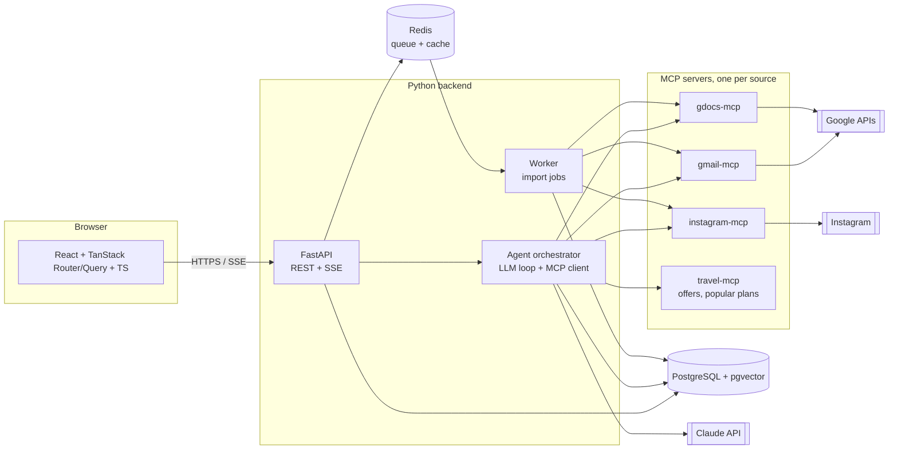

# Novoya architecture

Novoya is a travel agent. A user signs in with Google, optionally connects Gmail, Google Docs and Instagram, describes the trip they want, refines it in a preference panel, and gets a plan. If they choose nothing, they get a popular plan.

This document is the starting proposal. Change it by pull request, like code.

## 1. User flow

1. The user signs in with Google. The first sign-in creates the account. We only ask for `openid email profile` here.
2. The user can connect sources, one by one and only if they want: Gmail, Google Docs, Instagram. Each one asks for its own permission at that moment, not at sign-in.
3. An import runs in the background. It finds past trips and bookings (flights, hotels, agency confirmations) and saves them as structured `Trip` records.
4. The user types what they want ("a calm week by the sea in May").
5. The agent opens a preference panel: sections, each with tags to pick (style, rhythm, accommodation, activities, food, transport...).
6. The last step of the panel shows past experiences (from the import), maximum budget, number of travellers.
7. The agent builds the trip. If the user picked nothing, the backend returns a popular plan that fits the budget, group size and season.

## 2. System overview



| Part | Tech | Job |
|---|---|---|
| `apps/web` | React, TypeScript, Vite, TanStack Router, TanStack Query, TanStack Form | Pages, the dynamic panel, streaming the agent's progress |
| `apps/api` | Python 3.12, FastAPI, Pydantic v2, SQLAlchemy 2, Alembic | Auth, REST API, SSE stream, the agent orchestrator |
| `apps/worker` | Same codebase as the API, run as a worker (ARQ or Celery) | Long imports from Gmail/Docs/Instagram, re-extraction |
| `mcp/*` | Python MCP SDK | One small server per data source. The agent calls them as tools |
| Database | PostgreSQL + pgvector | Users, encrypted tokens, trips, wishes, plans, embeddings for search |
| Cache / queue | Redis | Job queue, rate limits, short-lived cache |
| LLM | Claude API (Anthropic Python SDK) | Extract trips from emails, build the panel, write the plan |

### Why MCP servers are separate

The agent only sees tools such as `gmail.search_bookings(query, since)` or `travel.popular_plans(budget, persons, month)`. It never sees OAuth tokens. The backend passes the user's token to the MCP server for each call. A new source (Outlook, WhatsApp export...) is then a new MCP server, with no change to the agent.

## 3. Two modes: import, then search

Do not search Gmail live on every request. It is slow and expensive.

- **Import (background, once + refresh)**: the worker asks the MCP servers for candidate messages and documents (senders such as booking.com, airbnb, airlines, known agencies; subjects such as "confirmation", "itinerary"). The LLM turns each one into a `Trip` record with a JSON schema. We store the extracted facts and the source link, **not** the raw email.
- **Search (live, during a chat)**: the agent searches the `trips` table first (SQL + pgvector). It calls an MCP tool live only when it needs a detail that is missing.

## 4. The dynamic panel

The LLM does not write UI. It returns JSON that matches a Pydantic schema, and the frontend renders it with generic components.

```json
{
  "sections": [
    {
      "id": "style",
      "title": "Travel style",
      "multi": true,
      "tags": [
        { "id": "beach", "label": "Beach", "preselected": true },
        { "id": "culture", "label": "Culture" }
      ]
    }
  ],
  "past_trips": ["trip_123", "trip_456"],
  "ask_budget": true,
  "ask_persons": true
}
```

The backend validates this JSON. If validation fails, it retries once, then falls back to a fixed default panel. The frontend has one `<PanelSection>` component and one `<TagPicker>`; it never needs to know which sections exist.

## 5. Popular plan fallback

If the user submits the panel with no tags:

1. The API skips the LLM planning step.
2. It reads `popular_plans`, filtered by budget, number of persons and month.
3. It returns the best match, marked `source: "popular"` so the UI can say so.

`popular_plans` starts as a hand-curated table. Later it can be filled from what other users booked.

## 6. Data model (first version)

| Table | Main columns |
|---|---|
| `users` | id, google_sub, email, name, created_at |
| `connections` | id, user_id, provider (`gmail`, `gdocs`, `instagram`), scopes, token_encrypted, status, last_sync_at |
| `trips` | id, user_id, destination, start_date, end_date, persons, price, currency, agency, kind (flight, hotel, package...), source_provider, source_ref, embedding |
| `wishes` | id, user_id, text, created_at |
| `panels` | id, wish_id, schema_json, answers_json, budget_max, persons |
| `plans` | id, wish_id, source (`agent` or `popular`), plan_json, created_at |
| `popular_plans` | id, title, destination, months, min_budget, max_budget, min_persons, max_persons, plan_json |

## 7. API (first version)

| Method | Path | What it does |
|---|---|---|
| GET | `/auth/google/login` | Start Google sign-in |
| GET | `/auth/google/callback` | Create or load the user, set a session cookie |
| POST | `/connections/{provider}` | Start the extra consent for Gmail, Docs or Instagram |
| DELETE | `/connections/{provider}` | Disconnect and delete the token and imported data |
| POST | `/imports` | Start an import job |
| GET | `/trips` | Past trips found for the user |
| POST | `/wishes` | Send the wish. Returns the panel |
| GET | `/wishes/{id}/stream` | SSE: the agent's progress ("reading your trips...") |
| POST | `/panels/{id}/answers` | Send tags, budget, persons. Returns the plan |

FastAPI generates the OpenAPI file. The frontend generates its TypeScript client and types from it (`@hey-api/openapi-ts` or `orval`), so both sides agree on types without writing them twice.

## 8. Repository layout

```
novoya/
  apps/
    web/            React + TanStack (pnpm)
    api/            FastAPI app, agent, worker (uv)
  mcp/
    gmail/
    gdocs/
    instagram/
    travel/
  docs/
    ARCHITECTURE.md
    adr/            one file per decision (0001-use-fastapi.md ...)
  docker-compose.yml   postgres, redis, api, worker, web
  .github/workflows/   branch rules, lint + tests per app
```

## 9. Constraints to know before we start

These change the plan, so the team should agree on them first.

- **Gmail is a "restricted" scope.** `gmail.readonly` works in testing with up to 100 listed users. Going public needs Google's verification and a yearly security assessment (CASA), which takes weeks and can cost money. Plan for it.
- **Google Docs**: `drive.readonly` is also restricted. Use the Google Picker with the `drive.file` scope instead: the user picks the documents to share, and that scope is not restricted.
- **Instagram**: Meta shut down the Basic Display API in December 2024. The official API now only works for Business and Creator accounts. For personal accounts, the realistic option is to let the user upload the ZIP from Instagram's "Download your information" and parse it. `instagram-mcp` should read that export.
- **Privacy (GDPR)**: store tokens encrypted, keep only extracted trip facts, let the user see and delete what we imported, and write a privacy policy. Google verification requires the policy anyway.
- **Real offers**: the plan needs prices and availability from somewhere (Amadeus, Booking affiliate, Skyscanner, partner agencies). This is still open and belongs to `travel-mcp`.

## 10. How the team splits the work

Agree on the API (section 7) first. Then the front and back can work in parallel against the OpenAPI file, with mocked responses on the frontend.

| Milestone | Backend | Frontend | Done when |
|---|---|---|---|
| M0 Setup | FastAPI skeleton, Postgres, Alembic, docker-compose, CI | Vite + TanStack skeleton, generated client, CI | `docker compose up` runs everything |
| M1 Auth | Google sign-in, sessions, `users` | Login page, protected routes | A user can sign in and out |
| M2 Wish + panel | `/wishes`, panel JSON from the LLM, validation, fallback panel | Wish input, generic panel renderer, budget and persons | Panel appears for any wish |
| M3 Plan + popular | Plan generation, `popular_plans` seed data, SSE | Plan page, progress stream, "popular" badge | Empty panel returns a popular plan |
| M4 Gmail | `gmail-mcp`, import job, trip extraction | Connect button, "your past trips" list | Real bookings show up for test users |
| M5 Docs + Instagram | `gdocs-mcp` with Picker, `instagram-mcp` from ZIP | Picker, ZIP upload | Trips from both sources appear |
| M6 Release prep | Google verification, privacy, delete-my-data | Privacy pages, settings | Ready for public users |

Each milestone is a set of `feature/...` branches into `dev`, following [CONTRIBUTING.md](../CONTRIBUTING.md). Record big choices (queue library, offers provider, hosting) as short ADRs in `docs/adr/`.
