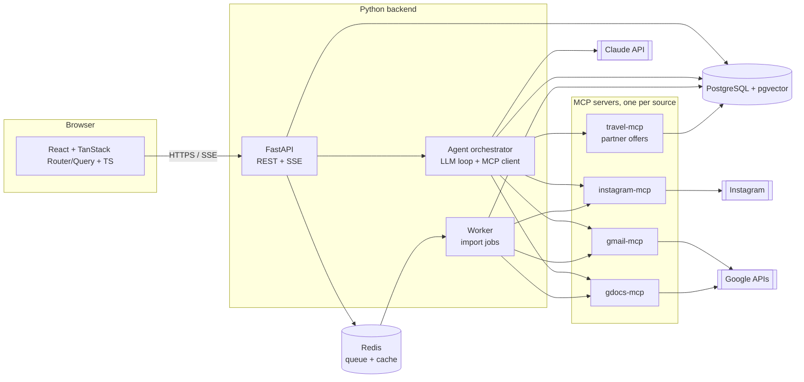

# Novoya architecture

Novoya is a travel agent. A user signs in with Google, optionally connects Gmail, Google Docs and Instagram, describes the trip they want, refines it in a preference panel, and gets a plan.

Novoya only sells what its partners (prestataires) offer: hotels, guides, transport and activities in the destinations they cover. Every plan is built from partner offers. If no partner covers a destination, Novoya cannot plan a trip there and says so.

This document is the starting proposal. Change it by pull request, like code.

## 1. User flow

1. The user signs in with Google. The first sign-in creates the account. We only ask for `openid email profile` here.
2. The user can connect sources, one by one and only if they want: Gmail, Google Docs, Instagram. Each one asks for its own permission at that moment, not at sign-in.
3. An import runs in the background. It finds past trips and bookings (flights, hotels, agency confirmations) and saves them as structured `Trip` records.
4. The user types what they want ("a calm week by the sea in May").
5. The agent checks coverage: is there at least one active partner at that destination? If not (for example Japan with no partner there), it says so and suggests covered destinations close to the wish. The flow stops here.
6. The agent opens a preference panel: sections, each with tags to pick (style, rhythm, accommodation, activities, food, transport...). The tags come from the partner offers at that destination, so the user can only pick what we can deliver.
7. The last step of the panel shows past experiences (from the import), maximum budget, number of travellers.
8. The agent builds the trip from partner offers. If the user picked no tags, it still builds a plan from the wish text, budget and travellers, starting with the offers partners mark as `featured`.

## 2. System overview



| Part | Tech | Job |
|---|---|---|
| `apps/web` | React, TypeScript, Vite, TanStack Router, TanStack Query, TanStack Form | Pages, the dynamic panel, streaming the agent's progress |
| `apps/api` | Python 3.12, FastAPI, Pydantic v2, SQLAlchemy 2, Alembic | Auth, REST API, SSE stream, the agent orchestrator |
| `apps/worker` | Same codebase as the API, run as a worker (ARQ or Celery) | Long imports from Gmail/Docs/Instagram, re-extraction |
| `mcp/*` | Python MCP SDK | One small server per data source. The agent calls them as tools |
| Database | PostgreSQL + pgvector | Users, encrypted tokens, past trips, partners and offers, wishes, plans, embeddings for search |
| Cache / queue | Redis | Job queue, rate limits, short-lived cache |
| LLM | Claude API (Anthropic Python SDK) | Extract trips from emails, build the panel, write the plan |

### Why MCP servers are separate

The agent only sees tools such as `gmail.search_bookings(query, since)` or `travel.search_offers(destination, tags, budget, persons, dates)`. It never sees OAuth tokens. The backend passes the user's token to the MCP server for each call. A new source (Outlook, WhatsApp export...) is then a new MCP server, with no change to the agent.

## 3. Two modes: import, then search

Do not search Gmail live on every request. It is slow and expensive.

- **Import (background, once + refresh)**: the worker asks the MCP servers for candidate messages and documents (senders such as booking.com, airbnb, airlines, known agencies; subjects such as "confirmation", "itinerary"). The LLM turns each one into a `Trip` record with a JSON schema. We store the extracted facts and the source link, **not** the raw email.
- **Search (live, during a chat)**: the agent searches the `trips` table first (SQL + pgvector). It calls an MCP tool live only when it needs a detail that is missing.

## 4. The dynamic panel

The LLM does not write UI. It returns JSON that matches a Pydantic schema, and the frontend renders it with generic components.

```json
{
  "sections": [
    {
      "id": "style",
      "title": "Travel style",
      "multi": true,
      "tags": [
        { "id": "beach", "label": "Beach", "preselected": true },
        { "id": "culture", "label": "Culture" }
      ]
    }
  ],
  "past_trips": ["trip_123", "trip_456"],
  "ask_budget": true,
  "ask_persons": true
}
```

The backend validates this JSON. If validation fails, it retries once, then falls back to a fixed default panel. The frontend has one `<PanelSection>` component and one `<TagPicker>`; it never needs to know which sections exist.

## 5. Partners, coverage and the no-preference case

Novoya works with a limited list of partners. The `partners` and `offers` tables are the catalog, and `travel-mcp` is the agent's only way to read it:

- `travel.covered_destinations()`: the countries and cities where at least one partner is active.
- `travel.search_offers(destination, tags, budget, persons, dates)`: offers that match.

This gives three cases:

| Case | What happens |
|---|---|
| Destination not covered | No panel. The agent explains it and suggests covered destinations. The wish is saved with status `not_covered`, so the team sees which destinations clients ask for and which partners to look for next. |
| Covered, tags picked | The agent builds the plan from offers that match the tags, budget, travellers and dates. |
| Covered, no tags picked | The agent builds the plan from the wish text, budget and travellers, starting with `featured` offers. The plan is marked `based_on_preferences: false` so the UI can say so. |

The LLM may only use offers returned by `travel-mcp`. The backend checks that every item in a plan points to a real `offer_id` before showing it.

## 6. Data model (first version)

| Table | Main columns |
|---|---|
| `users` | id, google_sub, email, name, created_at |
| `connections` | id, user_id, provider (`gmail`, `gdocs`, `instagram`), scopes, token_encrypted, status, last_sync_at |
| `trips` | id, user_id, destination, start_date, end_date, persons, price, currency, agency, kind (flight, hotel, package...), source_provider, source_ref, embedding |
| `partners` | id, name, kind (hotel, guide, transport, activity, agency), country, city, contact_email, active, created_at |
| `offers` | id, partner_id, kind, title, description, country, city, price, currency, price_unit (per person, per night, per group), min_persons, max_persons, available_from, available_to, tags, featured, active, embedding |
| `wishes` | id, user_id, text, destination_country, destination_city, status (`draft`, `not_covered`, `panel_shown`, `answered`, `planned`), panel_json (the panel we showed), selected_tags (what the user clicked, for example `[{"section": "style", "tag": "beach"}]`), budget_max, currency, persons, start_date, end_date, created_at, updated_at |
| `plans` | id, wish_id, based_on_preferences, total_price, currency, summary, created_at |
| `plan_items` | id, plan_id, offer_id, day, quantity, price |

`wishes` holds the whole request: the text, the panel we showed, the tags the user clicked, the budget and the number of travellers. `panel_json` and `selected_tags` are JSONB columns. If we later need statistics per tag ("how many clients pick beach"), we can add a `wish_tags` table (wish_id, section, tag) without changing the API.

## 7. API (first version)

| Method | Path | What it does |
|---|---|---|
| GET | `/auth/google/login` | Start Google sign-in |
| GET | `/auth/google/callback` | Create or load the user, set a session cookie |
| POST | `/connections/{provider}` | Start the extra consent for Gmail, Docs or Instagram |
| DELETE | `/connections/{provider}` | Disconnect and delete the token and imported data |
| POST | `/imports` | Start an import job (see below). Returns the job id |
| GET | `/imports/{id}` | Import progress: running, done or failed, and how many trips were found |
| GET | `/trips` | Past trips found for the user |
| GET | `/destinations` | Destinations covered by our partners |
| POST | `/wishes` | Send the wish. Returns the panel, or `not_covered` with suggested destinations |
| GET | `/wishes/{id}/stream` | SSE: the agent's progress ("reading your trips...") |
| POST | `/wishes/{id}/answers` | Send the selected tags, budget, travellers and dates. Saves them on the wish and returns the plan |
| GET, POST, PATCH | `/admin/partners`, `/admin/offers` | Team only: manage partners and their offers |

**What `/imports` does.** An import reads the sources the user connected (Gmail, Google Docs, the Instagram ZIP) and finds their past trips: flight and hotel confirmations, agency bookings, itineraries. For each one, the LLM extracts destination, dates, travellers, price and agency, and the worker saves a row in `trips`. Those rows are what the panel shows as "past experiences" and what the agent uses to know the user's taste (for example, they always pick small hotels). The import runs in the background because reading hundreds of emails takes minutes. It starts by itself right after the user connects a source. `POST /imports` is the "refresh" button that runs it again, and `GET /imports/{id}` lets the page show progress.

FastAPI generates the OpenAPI file. The frontend generates its TypeScript client and types from it (`@hey-api/openapi-ts` or `orval`), so both sides agree on types without writing them twice.

## 8. Repository layout

```
novoya/
  apps/
    web/            React + TanStack (pnpm)
    api/            FastAPI app, agent, worker (uv)
  mcp/
    gmail/
    gdocs/
    instagram/
    travel/
  docs/
    ARCHITECTURE.md
    adr/            one file per decision (0001-use-fastapi.md ...)
  docker-compose.yml   postgres, redis, api, worker, web
  .github/workflows/   branch rules, lint + tests per app
```

## 9. Constraints to know before we start

These change the plan, so the team should agree on them first.

- **Gmail is a "restricted" scope.** `gmail.readonly` works in testing with up to 100 listed users. Going public needs Google's verification and a yearly security assessment (CASA), which takes weeks and can cost money. Plan for it.
- For Google Docs, `drive.readonly` is also restricted. Use the Google Picker with the `drive.file` scope instead: the user picks the documents to share, and that scope is not restricted.
- **Instagram**: Meta shut down the Basic Display API in December 2024. The official API now only works for Business and Creator accounts. For personal accounts, the realistic option is to let the user upload the ZIP from Instagram's "Download your information" and parse it. `instagram-mcp` should read that export.
- For privacy (GDPR), store tokens encrypted, keep only extracted trip facts, let the user see and delete what we imported, and write a privacy policy. Google verification requires the policy anyway.
- Plans are only as good as the `offers` table. For now the team enters partners and offers through the admin endpoints. Still open: how partners keep prices and availability up to date (the team updates them, a partner portal, or an import from the partner's system).

## 10. How the team splits the work

Agree on the API (section 7) first. Then the front and back can work in parallel against the OpenAPI file, with mocked responses on the frontend.

| Milestone | Backend | Frontend | Done when |
|---|---|---|---|
| M0 Setup | FastAPI skeleton, Postgres, Alembic, docker-compose, CI | Vite + TanStack skeleton, generated client, CI | `docker compose up` runs everything |
| M1 Auth | Google sign-in, sessions, `users` | Login page, protected routes | A user can sign in and out |
| M2 Partners + wish + panel | `partners` and `offers` with seed data, admin endpoints, `travel-mcp`, `/wishes` with coverage check, panel built from partner tags | Wish input, "not covered" message, generic panel renderer, budget and travellers, simple admin pages | A covered wish shows a panel; an uncovered one is refused politely |
| M3 Plan | Plan generation from offers, `plans` and `plan_items`, offer-id check, SSE | Plan page, progress stream | Every plan item is a real partner offer, with or without tags |
| M4 Gmail | `gmail-mcp`, import job, trip extraction | Connect button, "your past trips" list | Real bookings show up for test users |
| M5 Docs + Instagram | `gdocs-mcp` with Picker, `instagram-mcp` from ZIP | Picker, ZIP upload | Trips from both sources appear |
| M6 Release prep | Google verification, privacy, delete-my-data | Privacy pages, settings | Ready for public users |

Each milestone is a set of `feature/...` branches into `dev`, following [CONTRIBUTING.md](../CONTRIBUTING.md). Record big choices (queue library, how partners update offers, hosting) as short ADRs in `docs/adr/`.
