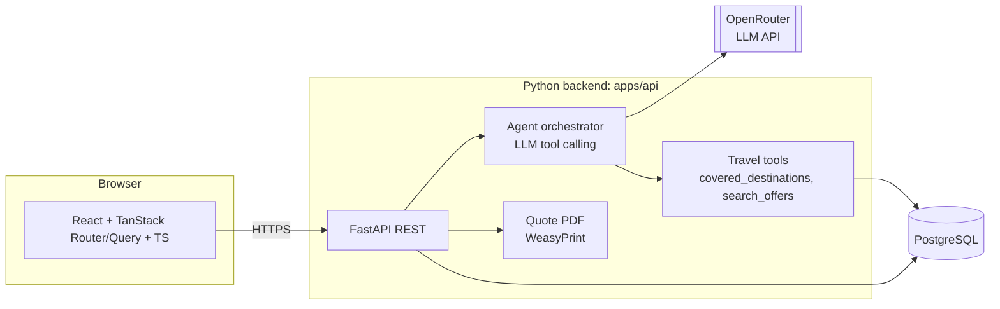
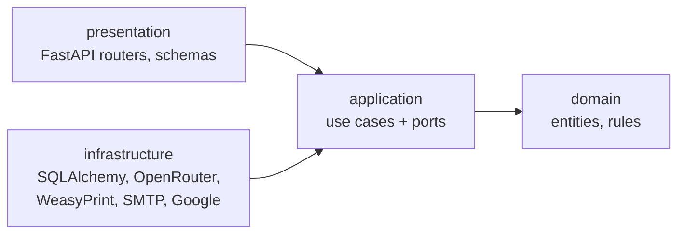
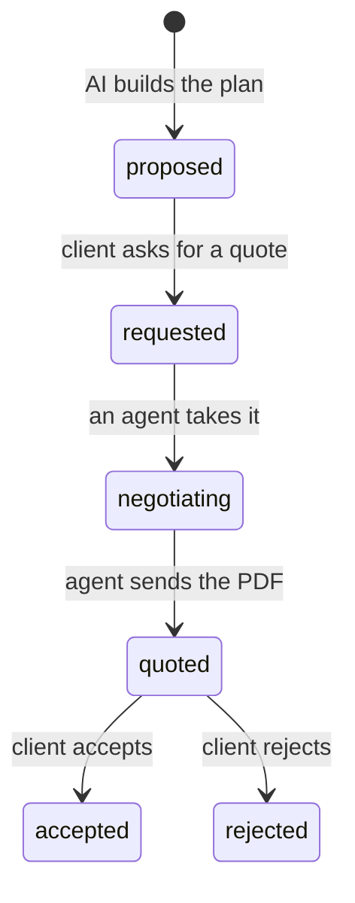

# Novoya architecture

Novoya is a travel agency with an AI assistant. A client signs in with Google, describes the trip they want, refines it in a preference panel, and gets a proposed plan built only from partner offers. A human travel agent from the agency then negotiates the prices with the partners and sends the client a PDF quote with the total price. The client accepts or rejects it.

Novoya only sells what its partners (prestataires) offer: hotels, guides, transport and activities in the destinations they cover. If no partner covers a destination, Novoya cannot plan a trip there and says so.

Two decisions shape this version:

- **No import of the client's past trips.** Reading Gmail, Google Docs or Instagram to find past trips was refused by the school as not GDPR compliant. Novoya only stores what the client types into it.
- **No fixed prices.** Partner prices are negotiated for each trip. The AI never shows a price. Only the quote written by a human agent has one.

This document is the starting proposal. Change it by pull request, like code.

## 1. User flow

### Client

1. The client signs in with Google. The first sign-in creates the account. We only ask for `openid email profile`.
2. The client types what they want ("a calm week by the sea in May").
3. The AI checks coverage: is there at least one active partner at that destination? If not (for example Japan with no partner there), it says so and suggests covered destinations close to the wish. The flow stops here.
4. The AI opens a preference panel: sections, each with tags to pick (style, rhythm, accommodation, activities, food, transport...). The tags come from the partner offers at that destination, so the client can only pick what we can deliver.
5. The last step of the panel asks for the maximum budget, the number of travellers and the dates.
6. The AI builds a proposed plan from partner offers, day by day, **without prices**. If the client picked no tags, it builds the plan from the wish text, budget and travellers, starting with the offers partners mark as `featured`.
7. The client asks the agency for a quote on that plan.
8. When the quote is ready, the client gets an email with a button to log in. They open the quote PDF in their account and accept or reject it.

### Travel agent (agency staff)

1. The agent signs in with Google. Their account has the `agent` role.
2. The agent sees the list of plans waiting for a quote, with the client's wish, budget, travellers and dates.
3. The agent takes a plan and negotiates with each partner outside Novoya (phone, email).
4. For each plan item, the agent enters the negotiated price. They can remove an item a partner cannot deliver.
5. The agent generates the quote: Novoya computes the total, renders the PDF, makes it visible to the client and emails them.
6. The agent sees when the client accepts or rejects.

Agents also manage partners and offers in the admin pages.

## 2. System overview



| Part | Tech | Job |
|---|---|---|
| `apps/web` | React, TypeScript, Vite, TanStack Router, TanStack Query, TanStack Form | Client pages (wish, panel, plan, quote) and agent pages (quote queue, pricing, partners and offers) |
| `apps/api` | Python 3.12, FastAPI, Pydantic v2, SQLAlchemy 2, Alembic | Clean Architecture: domain, use cases, adapters (database, LLM, PDF, email, Google sign-in) and the REST API |
| Database | PostgreSQL | Users, partners and offers, wishes, plans, quotes |
| LLM | OpenRouter, called with the OpenAI Python SDK | Check coverage, build the panel, write the plan |

There is no worker, no queue and no MCP server in this version. Nothing runs in the background: every AI call happens during a request and takes a few seconds.

### Backend layers: Clean Architecture

The backend follows Clean Architecture. It has four layers, and source code dependencies only point inward:



| Layer | Holds | Knows about |
|---|---|---|
| Domain | Entities (User, Partner, Offer, Wish, Plan, Quote), value objects (Money, DateRange, Tag), business rules such as the allowed plan status changes, domain errors | Nothing else. Pure Python |
| Application | One use case per user action (`send_wish`, `generate_plan`, `request_quote`, `send_quote`, `decide_quote`...) and the ports they need: `PlanRepository`, `PlanGenerator`, `QuoteRenderer`, `QuoteNotifier`... | Domain |
| Infrastructure | Adapters that implement the ports: SQLAlchemy repositories, the OpenRouter client and travel tools, the WeasyPrint PDF, the SMTP email, Google OAuth | Application, domain |
| Presentation | FastAPI routers and Pydantic schemas. They turn a request into a use case call, and a result or a domain error into a response | Application, domain |

The composition root (`main.py` and `presentation/http/dependencies.py`) plugs the adapters into the use cases. What this buys us:

- Business rules are tested without a database, a web server or an LLM, with fake ports.
- Changing a tool touches one adapter. Switching LLM model or provider changes `infrastructure/llm` only; moving from SMTP to an email API changes `infrastructure/email` only.
- A test (`tests/test_architecture.py`) reads every import and fails in CI if a layer breaks the rule, so the structure stays clean over time.

### Travel tools, in-process

The agent orchestrator gives the LLM two tools through the `tools` parameter (tool calling). They are plain Python functions in `apps/api` (`infrastructure/llm/tools`) that read the catalog through the `OfferRepository` port:

- `covered_destinations()`: the countries and cities where at least one partner is active.
- `search_offers(destination, tags, persons, dates)`: active offers that match.

When the LLM asks for a tool, the orchestrator runs the function and sends the result back. The LLM never touches the database directly.

### The LLM: OpenRouter

The school asks for a model served through OpenRouter. OpenRouter's API is compatible with OpenAI's, so the backend uses the official `openai` Python SDK with a different base URL:

```python
client = AsyncOpenAI(base_url="https://openrouter.ai/api/v1", api_key=settings.openrouter_api_key)
```

- The model is a setting, `NOVOYA_LLM_MODEL`, so we can switch models without changing code. It must support tool calling (OpenRouter lists this as `tools` in the model's supported parameters).
- The API key is `NOVOYA_OPENROUTER_API_KEY`. It stays on the server and never reaches the browser.
- Not every model follows a JSON schema reliably, so the backend validates every answer with Pydantic, retries once, then falls back (see section 3).
- Tests use a fake client. CI makes no live LLM calls.

## 3. The dynamic panel

The LLM does not write UI. It returns JSON that matches a Pydantic schema, and the frontend renders it with generic components.

```json
{
  "sections": [
    {
      "id": "style",
      "title": "Travel style",
      "multi": true,
      "tags": [
        { "id": "beach", "label": "Beach", "preselected": true },
        { "id": "culture", "label": "Culture" }
      ]
    }
  ],
  "ask_budget": true,
  "ask_persons": true,
  "ask_dates": true
}
```

The backend validates this JSON. If validation fails, it retries once, then falls back to a panel built directly from the tags of the offers at that destination. The frontend has one `<PanelSection>` component and one `<TagPicker>`; it never needs to know which sections exist.

## 4. Partners, coverage and the no-preference case

Novoya works with a limited list of partners. The `partners` and `offers` tables are the catalog, and the travel tools are the AI's only way to read it.

| Case | What happens |
|---|---|
| Destination not covered | No panel. The AI explains it and suggests covered destinations. The wish is saved with status `not_covered`, so the team sees which destinations clients ask for and which partners to look for next. |
| Covered, tags picked | The AI builds the plan from offers that match the tags, travellers and dates. |
| Covered, no tags picked | The AI builds the plan from the wish text, budget and travellers, starting with `featured` offers. The plan is marked `based_on_preferences: false` so the UI can say so. |

The AI may only use offers returned by `search_offers`. The backend checks that every item in a plan points to a real, active `offer_id` before saving it.

Offers have no price. The client's budget is saved on the wish and shown to the human agent, who negotiates within it.

## 5. From plan to quote

A plan moves through these statuses:



- **proposed**: the client sees the plan, with no price.
- **requested**: the plan is in the agents' queue.
- **negotiating**: one agent owns it (`assigned_agent_id`). They enter a negotiated price on each item.
- **quoted**: every remaining item has a price. The agent clicked "Send quote". The backend computes the total, saves a `quotes` row and renders the PDF.
- **accepted** or **rejected**: the client's final answer. A rejected client can start a new wish.

### The quote PDF

The PDF is an HTML template (Jinja2) rendered with WeasyPrint. The client reads it in their account.

When the quote is sent, the client gets an email in their language (English or French). It says their offer is available in their account and has one button, "Log in to see my quote", that opens the quote after sign-in. The email holds no PDF, prices or partner names. It is sent over SMTP (`NOVOYA_SMTP_*` settings); locally, Mailpit in docker-compose catches it.

| Shown on the PDF | Not shown |
|---|---|
| Quote number, issue date, valid until (7 days after sending) | Partner names: the client sees what is booked, not who provides it |
| Client, destination, dates, travellers, the agent's contact | A separate agency fee line: any margin is already inside the item prices |
| The wish text and the tags picked | |
| The plan day by day: each item, quantity and price | |
| The total and, under it, the client's maximum budget | |
| How to accept or reject, and what is not included (flights, other meals, drinks, tips, insurance) | |

The PDF exists in English and French, in the client's language (`users.locale`). Prices are in euros.

## 6. Data model (first version)

| Table | Main columns |
|---|---|
| `users` | id, google_sub, email, name, role (`client`, `agent`), locale (`en`, `fr`), created_at |
| `partners` | id, name, kind (hotel, guide, transport, activity, agency), country, city, contact_email, contact_phone, active, created_at |
| `offers` | id, partner_id, kind, title, description, country, city, min_persons, max_persons, available_from, available_to, tags, featured, active |
| `wishes` | id, user_id, text, destination_country, destination_city, status (`draft`, `not_covered`, `panel_shown`, `answered`, `planned`), panel_json (the panel we showed), selected_tags (what the client clicked, for example `[{"section": "style", "tag": "beach"}]`), budget_max, currency, persons, start_date, end_date, created_at, updated_at |
| `plans` | id, wish_id, status (`proposed`, `requested`, `negotiating`, `quoted`, `accepted`, `rejected`), based_on_preferences, summary, assigned_agent_id, created_at, updated_at |
| `plan_items` | id, plan_id, offer_id, day, quantity, note, negotiated_price (empty until the agent fills it), removed |
| `quotes` | id, number, plan_id, agent_id, total_price, currency (`EUR`), locale, valid_until, pdf_path, sent_at, decided_at, client_comment |

`wishes` holds the whole request: the text, the panel we showed, the tags the client clicked, the budget, the number of travellers and the dates. `panel_json` and `selected_tags` are JSONB columns.

Agents are set by email: the first agents come from the `NOVOYA_AGENT_EMAILS` setting, and their role is set to `agent` when they sign in.

## 7. API (first version)

Client:

| Method | Path | What it does |
|---|---|---|
| GET | `/auth/google/login` | Start Google sign-in |
| GET | `/auth/google/callback` | Create or load the user, set a session cookie |
| POST | `/auth/logout` | Sign out |
| GET | `/me` | The signed-in user and their role |
| GET | `/destinations` | Destinations covered by our partners |
| POST | `/wishes` | Send the wish. Returns the panel, or `not_covered` with suggested destinations |
| POST | `/wishes/{id}/answers` | Send the selected tags, budget, travellers and dates. Saves them on the wish and returns the proposed plan |
| GET | `/plans/{id}` | The plan, day by day, with no prices until it is quoted and no partner names |
| POST | `/plans/{id}/request-quote` | Ask the agency for a quote |
| GET | `/quotes/{id}/pdf` | Download the quote PDF |
| POST | `/quotes/{id}/accept`, `/quotes/{id}/reject` | The client's answer, with an optional comment |
| DELETE | `/me` | Delete the account, its wishes, plans and quotes |

Agent (role `agent` only):

| Method | Path | What it does |
|---|---|---|
| GET | `/agent/plans?status=requested` | The quote queue |
| POST | `/agent/plans/{id}/take` | Assign the plan to me, status `negotiating` |
| PATCH | `/agent/plans/{id}/items/{item_id}` | Set the negotiated price, or remove the item |
| POST | `/agent/plans/{id}/quote` | Compute the total, render the PDF, status `quoted` |
| GET, POST, PATCH | `/admin/partners`, `/admin/offers` | Manage partners and their offers |

FastAPI generates the OpenAPI file. The frontend generates its TypeScript client and types from it with `@hey-api/openapi-ts`, so both sides agree on types without writing them twice.

## 8. Repository layout

```
novoya/
  apps/
    web/                     React + TanStack (pnpm)
    api/                     FastAPI (uv)
      src/novoya_api/
        domain/              entities, value objects, rules, errors
        application/         use_cases/, ports/
        infrastructure/      db/, llm/, pdf/, email/, auth/
        presentation/http/   routers/, schemas/, dependencies.py
        main.py              composition root
      tests/                 unit tests with fake ports, API tests, test_architecture.py
      alembic/               migrations
  docs/
    ARCHITECTURE.md
    adr/                     one file per decision (0001-use-fastapi.md ...)
  docker-compose.yml         postgres, api, web, mailpit
  .github/workflows/         branch rules, lint + tests per app
```

## 9. Privacy (GDPR)

- We store only the Google account (email, name), what the client types (wishes, panel answers, budget, travellers, dates), the plans and the quotes. No mailbox, document or social media data.
- A privacy page says what we store, why, and for how long.
- The client can delete their account and everything linked to it (`DELETE /me`).
- Agents see client data only for the plans in their queue.

## 10. Schedule: 5 days, three sprints

The team is three developers who use Claude Code as a coding assistant. Sprints last two days, so the five days split into two 2-day sprints and a 1-day sprint for the finish.

| Sprint | Days | Backend | Frontend | Done when |
|---|---|---|---|---|
| Sprint 1 | Fri 16, Mon 19 Oct | Merge the M0 setup, Google sign-in with roles, `partners` and `offers` with seed data, OpenRouter LLM client and orchestrator, travel tools, `/destinations`, `/wishes` with coverage check | Login and protected routes, wish input, "not covered" message | A signed-in client sends a wish and gets a panel or a polite "not covered" |
| Sprint 2 | Tue 20, Wed 21 Oct | Panel from partner tags, `/answers`, plan generation with the offer-id check, `request-quote`, agent queue and pricing endpoints, admin endpoints | Panel renderer with budget, travellers and dates, plan page without prices, agent queue and pricing page | A client gets a plan from real offers and asks for a quote; an agent enters prices |
| Sprint 3 | Thu 22 Oct | Quote PDF, email to the client, accept and reject, `DELETE /me` | Quote page with PDF and accept/reject, privacy page | The full flow works end to end for the demo |

Stretch goals if time is left: admin pages for partners and offers (until then, seed data and the API) and a progress stream while the plan is built.

Each sprint is a set of `feature/...` branches into `dev`, following [CONTRIBUTING.md](../CONTRIBUTING.md). Record big choices as short ADRs in `docs/adr/`.
