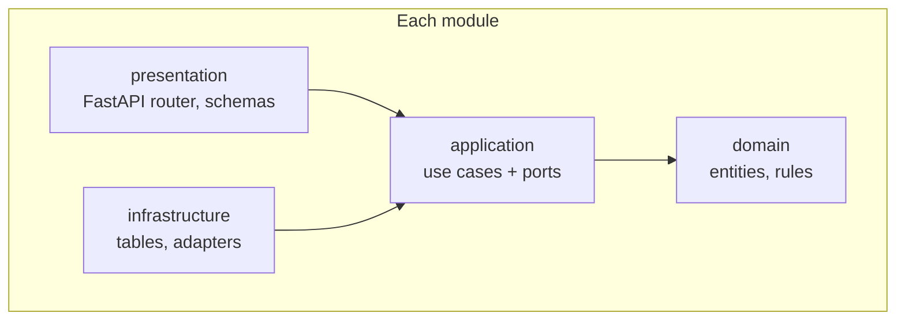
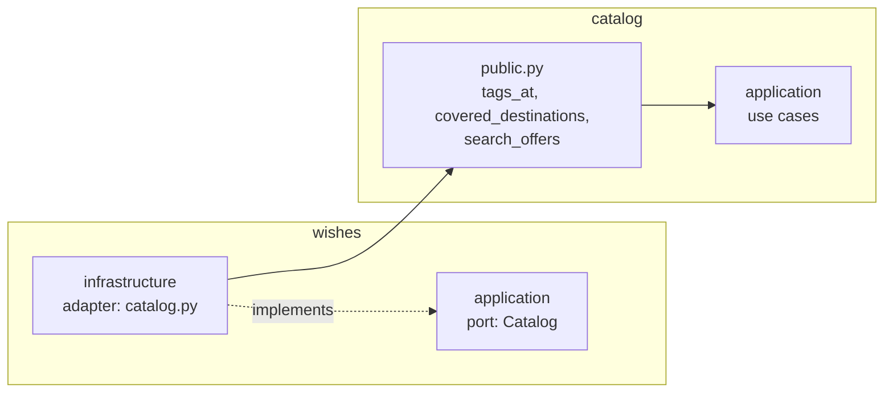
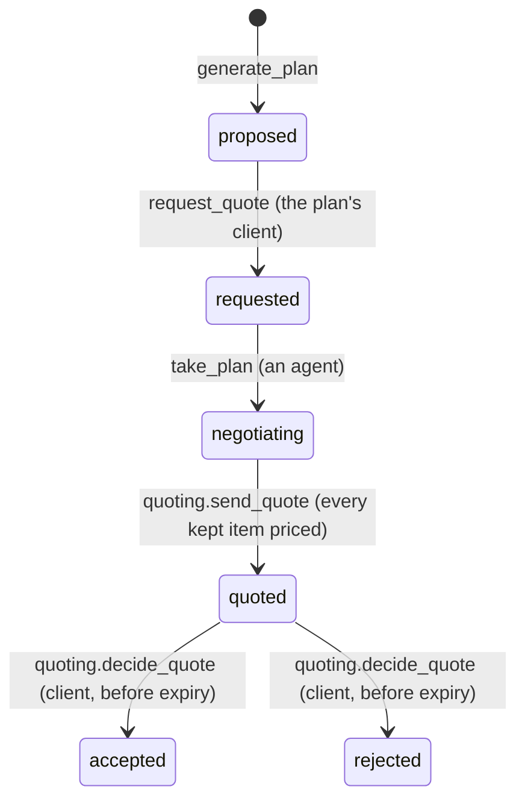
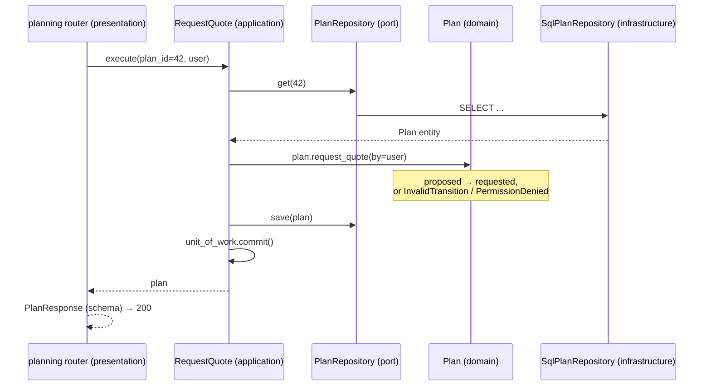

# Novoya backend architecture

This page explains how the backend in `apps/api` is built: its modules, the layers inside each module, where each piece of code goes, and the rules that keep it clean. The product, the data model and the API list are in [ARCHITECTURE.md](ARCHITECTURE.md).

## 1. Modules, then layers

The backend is a **modular monolith built with Clean Architecture**. One application, one database, one deployment, organised in two directions:

- **Vertically, by business module.** Each module owns one part of Novoya: its entities, its rules, its tables and its endpoints.
- **Horizontally, by Clean Architecture layer, inside every module.** Source code dependencies only point inward.



| Module | Owns | Issues |
|---|---|---|
| `accounts` | Users, sign-in with Google or email and password, sessions, the client, agent and admin roles, the language, deleting an account | #15, #49, #46, #59 |
| `catalog` | Partners, offers, covered destinations, published reviews, extras, the DÉTOUR import | #17, #18, #20, #21, #83, #119 |
| `wishes` | The client's wish, the coverage check, the preference panel and its answers | #23, #25, #28 |
| `planning` | The plan built from offers and its status machine, the agent's negotiation (queue, prices) | #29, #76, #50, #51 |
| `quoting` | The quote: total, validity, PDF, email, the client's accept or reject | #52, #53, #54 |
| `dashboard` | The admin home's key numbers, counted by each module through its `public.py`. No table | #131 |
| `health` | Is the API up, does the database answer. The worked example to copy | done |
| `shared` | The shared kernel: domain errors, common value objects, the database session, the LLM client | |

Why both: layers keep business rules independent from tools (FastAPI, PostgreSQL, OpenRouter, WeasyPrint, SMTP). Modules keep each part of the business in one folder, so one developer can own a module and conflicts stay rare.

## 2. Folders

```
apps/api/src/novoya_api/
  main.py              creates the FastAPI app and includes each module's router
  config.py            settings from NOVOYA_* environment variables
  openapi.py           prints openapi.json for the frontend

  accounts/  catalog/  wishes/  planning/  quoting/  dashboard/  health/
    public.py          the only file other modules may import (not in health)
    domain/            entities, value objects, business rules. Pure Python
    application/
      ports/           interfaces the use cases need (typing.Protocol)
      use_cases/       one module per user action
    infrastructure/
      db/models.py     this module's tables
      ...              adapters: repositories, LLM, PDF, email, calls to other modules
    presentation/http/
      router.py        this module's endpoints
      schemas.py       Pydantic request and response models
      dependencies.py  composition root: builds use cases with their adapters

  shared/
    domain/            errors.py (DomainError, NotFound, PermissionDenied, InvalidTransition,
                       Unauthenticated, Conflict, InvalidInput, TooManyRequests),
                       value objects (Money, DateRange, Destination, Locale)
    application/       UnitOfWork and Clock ports
    infrastructure/    db/ (Base, session), llm/ (OpenRouter client, tool-calling loop)
    presentation/      domain error → HTTP response handler
```

Every package's `__init__.py` lists the files planned in it and the issue that adds each one. `health/` is complete and runs today; the others are ready to fill.

## 3. Layers inside a module

| Layer | Holds | May import |
|---|---|---|
| `domain/` | Entities, value objects, business rules | Its own domain, `shared.domain`, the standard library |
| `application/` | Use cases and ports | Its own domain and application, `shared.domain`, `shared.application` |
| `infrastructure/` | Adapters implementing the ports, the module's tables | Its own domain, application and infrastructure, `shared`, `config`, other modules' `public.py` |
| `presentation/` | Router, schemas, composition root | Its own domain, application and presentation, `shared`, `config`, other modules' `public.py`. Its own infrastructure only in `dependencies.py` |

How the inner layers use tools without importing them: the application layer declares **ports** (interfaces) for what it needs, such as "save a plan" or "render a quote". The infrastructure layer provides **adapters** that implement them. Each module's `dependencies.py`, the **composition root**, plugs adapters into use cases when a request arrives.

## 4. How modules talk to each other

A module never reaches into another module's code or tables. It uses only the other module's `public.py`, and only from the outside of its own layers:



1. The use case in `wishes` needs catalog data, so `wishes/application/ports/` declares a `Catalog` port in its own words.
2. `wishes/infrastructure/catalog.py` implements that port by calling `catalog.public`.
3. `catalog/public.py` exposes a few functions and read-only views, backed by catalog's use cases.

So the inner layers of a module never know other modules exist, and each module can change its internals freely as long as its `public.py` stays the same.

| Module | Uses | Through |
|---|---|---|
| `wishes` | `catalog` (coverage, tags), `planning` (start a plan) | `catalog.public`, `planning.public` |
| `planning` | `catalog` (check offer ids, LLM travel tools) | `catalog.public` |
| `quoting` | `planning` (priced plan, mark quoted, accepted or rejected), `accounts` (email, language) | `planning.public`, `accounts.public` |
| `messaging` | `wishes` (the wish's client), `planning` (the plans' status and agent, for the chat's read rule) | `wishes.public`, `planning.public` |
| `accounts` | `wishes`, `planning`, `quoting` (delete a user's data) | each `public.delete_for_user` |
| `dashboard` | `accounts`, `catalog`, `planning`, `quoting` (counts for the admin home) | each `public.count_*` |
| all routers | `accounts` (`current_user`, `require_client`, `require_agent`, `require_admin`, `Role`, `get_user`) | `accounts.public` |

Each module owns its tables. Foreign keys across modules are allowed in the database, but code reads another module's data only through `public.py`.

## 5. Inside the modules

### Entities and rules

| Module | Entities | Rules they own |
|---|---|---|
| accounts | `User`, `Role`, `PasswordCredential`, `OAuthIdentity`, `AuthSession`, `OneTimeToken`, `RoleChange` | A new account is `client`, and signing in never changes a role. Only an admin changes a role, never their own, and there is always at least one admin. `agent` and `admin` need a verified email. A password account cannot sign in before its email is verified. Only agents (and admins) handle quotes |
| catalog | `Partner`, `Offer`, `Review`, `Extra` | An inactive or hidden partner's offers are never used, nor a hidden offer or extra. DÉTOUR owns imported rows: only `featured` and `hidden` change in Novoya (`ImportedRow`, 409). An offer fits a group size and dates or not. An offer's price is **indicative only** (offer page): price and unit come together, more than 0, opening months 1 to 12 ([ADR 0014](adr/0014-indicative-prices-and-detour-import.md)). A review is rated 1 to 5 and keeps its author as given. An extra is `included`, `supplement` (with an amount more than 0) or `on_quote` (no amount) |
| wishes | `Wish`, `Panel`, `Tag` | `draft` → `not_covered` or `panel_shown` → `answered` → `planned`. Selected tags must come from the panel shown |
| planning | `Plan`, `PlanItem`, `PlanExtra` | The status machine below. Every item is a real, active offer. Only the assigned agent sets prices. Extras are chosen when the quote is requested; a supplement is counted once (one per person, night or day needs the agent's confirmation), an `on_quote` extra needs the agent's price before the plan is ready to quote, an `included` one is never counted |
| quoting | `Quote` | Total = sum of the kept items' prices plus the priced extras (each once). Valid 7 days. Answered once, before it expires |

The plan's status machine lives in `planning/domain`:



The allowed moves are methods on `Plan`, for example `plan.request_quote(by=user)`. Any other move raises `InvalidTransition`. `quoting` moves a plan only through `planning.public`.

### Use cases and ports

| Module | Use cases | Endpoints | Ports |
|---|---|---|---|
| accounts | `StartSignIn`, `SignIn`, `Register`, `VerifyEmail`, `SignInWithPassword`, `RequestPasswordReset`, `ResetPassword`, `ChangePassword`, `SignOut`, `SignOutEverywhere`, `GetCurrentUser`, `ChangeLocale`, `ListUsers`, `ChangeUserRole`, `DeleteAccount` | `/auth/{provider}/*` (Google), `/auth/register`, `/auth/login`, `/auth/email/*`, `/auth/password/*`, `/auth/logout`, `/auth/logout-all`, `GET /me`, `PATCH /me`, `DELETE /me`, `/admin/users` | UserRepository, PasswordCredentialRepository, OAuthIdentityRepository, SessionRepository, IdentityProvider, PasswordHasher, AuthMailer, RateLimiter, PersonalDataEraser |
| catalog | `ListDestinations`, `SearchOffers`, `ManagePartners`, `ManageOffers`, `GetOfferDetail`, `ListReviews`, `ListAllReviews`, `UpdateReview`, `ListExtras`, `GetExtras`, `ListAllExtras`, `UpdateExtra` | `GET /destinations`, `GET /offers/{id}`, `GET /reviews`, `GET /extras`, `/admin/partners`, `/admin/offers`, `/admin/extras`, `/admin/reviews` | PartnerRepository, OfferRepository, ReviewRepository, ExtraRepository |
| wishes | `SendWish`, `AnswerPanel` | `POST /wishes`, `POST /wishes/{id}/answers` | WishRepository, Catalog, PanelBuilder, PlanStarter |
| planning | `GeneratePlan`, `GetPlan`, `RequestQuote`, `ListQuoteQueue`, `TakePlan`, `SetItemPrice`, `SetExtraPrice` | `GET /plans/{id}`, `POST /plans/{id}/request-quote`, `/agent/plans/*` | PlanRepository, PlanGenerator, Catalog |
| quoting | `SendQuote`, `GetQuote`, `DownloadQuotePdf`, `DecideQuote` | `POST /agent/plans/{id}/quote`, `/quotes/{id}`, `/quotes/{id}/pdf`, `/accept`, `/reject` | QuoteRepository, Plans, Users, QuoteRenderer, QuoteNotifier |
| trips | `ListMyTrips` | `GET /me/trips` | TripWishes, TripPlans, TripQuotes |
| dashboard | `GetAdminStats` | `GET /admin/stats` | Counts |
| health | `CheckDatabase` | `GET /health`, `GET /health/db` | DatabaseProbe |

Every module also uses the shared `UnitOfWork` port: one use case is one transaction.

### Adapters

| Module | Adapter | Tool |
|---|---|---|
| all | `infrastructure/db/` repositories and tables | SQLAlchemy 2 (async) + PostgreSQL |
| catalog | `detour/` (read.py, mapping.py, run.py) | The DÉTOUR sqlite export, opened read-only with `sqlite3`; one transaction, counts only, errors name DÉTOUR ids ([ADR 0014](adr/0014-indicative-prices-and-detour-import.md)) |
| catalog | `countries.py` | Country names in French or English to the English name Novoya stores, from Babel's CLDR names; used by the import and by `catalog.public.canonical_country` |
| accounts | `google_oauth.py`, `security.py`, `email/` | Google OpenID Connect with Authlib (`openid email profile`, PKCE), Argon2id password hashes, SMTP (Mailpit locally) |
| wishes | `llm/panel_builder.py` | OpenRouter, through `shared/infrastructure/llm` |
| planning | `llm/plan_generator.py`, `llm/tools.py` | OpenRouter tool calling; `travel_tools()` reads offers through `catalog.public` and sends them without partner name or contact |
| quoting | `pdf/`, `email/` | Jinja2 + WeasyPrint, SMTP (Mailpit locally) |

ORM models are not entities. A repository maps rows to entities and back, so no SQLAlchemy object leaves a module's `infrastructure/`.

### The LLM proposes, the use case decides

The LLM is an adapter behind `PanelBuilder` (wishes) and `PlanGenerator` (planning):

- `GeneratePlan` keeps only the items whose `offer_id` is a real, active offer that fits the travellers and dates. That check is a domain rule in `planning`, applied to every plan whatever the model returns.
- If the model fails or returns invalid JSON twice, the adapter raises and the use case falls back, for example to a panel built from the offers' tags.
- Changing the model (`NOVOYA_LLM_MODEL`) or the provider touches `shared/infrastructure/llm/` only.

### Domain errors and HTTP

Errors are defined once in `shared/domain/errors.py` and turned into HTTP codes by one handler in `shared/presentation`:

| Domain error | HTTP |
|---|---|
| `Unauthenticated` | 401 |
| `PermissionDenied` | 403 |
| `NotFound` | 404 |
| `InvalidTransition`, `Conflict` | 409 |
| `InvalidInput`, invalid input (Pydantic) | 422 |
| `TooManyRequests` | 429, with `Retry-After` |

Every error has a `code`, and the API answers `{code, detail}`, so the frontend can translate the message. Module errors extend these classes (for example `InvalidCredentials` extends `Unauthenticated`), so the one handler is enough.

"Destination not covered" is not an error: it is a normal result of `SendWish`, returned with status 200 and `not_covered`.

## 6. One request, end to end

The client asks for a quote (`POST /plans/42/request-quote`, #50). Everything happens inside `planning`:



The router never sees SQL, the use case never sees HTTP, and the rule "only the plan's client, only from `proposed`" exists in one place: `Plan.request_quote`.

### The module that already runs

`health` goes through every layer and is the model for a new module:

| Layer | File | Role |
|---|---|---|
| application | `health/application/ports.py` | `DatabaseProbe` with `ping()` |
| application | `health/application/use_cases/check_database.py` | `CheckDatabase`: `True` if the probe answers |
| infrastructure | `health/infrastructure/sql_probe.py` | `SqlDatabaseProbe`: `SELECT 1` |
| presentation | `health/presentation/http/dependencies.py` | builds `CheckDatabase(SqlDatabaseProbe(session))` |
| presentation | `health/presentation/http/router.py`, `schemas.py` | calls the use case, answers 200 or 503 |

## 7. Tests

| What | How | Needs |
|---|---|---|
| Domain rules (status machine, totals, validity) | Plain unit tests on entities | Nothing |
| Use cases | Call the use case with fake ports (in-memory repositories, a fake LLM, a fake catalog) | Nothing |
| Adapters | Run repositories against a real PostgreSQL | The Postgres service in CI |
| HTTP | `httpx` against the app, with `app.dependency_overrides` replacing adapters | Nothing |
| Architecture | `tests/test_architecture.py` | Nothing |

CI never calls the real LLM, SMTP server or Google. `tests/test_check_database.py` (use case with a fake port) and `tests/test_health.py` (HTTP with an overridden dependency) are the examples to copy.

### The architecture test

`tests/test_architecture.py` reads every import in `src/novoya_api` and fails, with the file and the reason, when:

- a domain or application layer imports a framework (FastAPI, SQLAlchemy, Pydantic, `openai`, WeasyPrint, Jinja2...);
- a layer imports an outer layer of its own module (for example application → infrastructure);
- presentation imports infrastructure anywhere but its `dependencies.py`;
- a module imports another module's internals instead of its `public.py`;
- a domain or application layer uses another module at all (it must declare a port);
- `shared` imports a module.

Two more tests plant forbidden and allowed imports in temporary files, so the guard cannot silently stop working.

## 8. Adding a feature, step by step

Example: "ask for a quote" (#50), in `planning`.

1. **Domain**: add `Plan.request_quote(by)` with its rule in `planning/domain/`, and test it.
2. **Application**: add the port methods you need (`PlanRepository.get`, `save`) in `planning/application/ports/` and the use case `planning/application/use_cases/request_quote.py`. Test it with a fake repository.
3. **Infrastructure**: implement the port in `planning/infrastructure/db/`, plus the table in `models.py` and an Alembic migration if a table changes.
4. **Presentation**: add the schema and the route in `planning/presentation/http/`, and the wiring in `dependencies.py`. Include the router in `main.py` if it is the module's first one.
5. If another module needs this, expose it in `planning/public.py`, nowhere else.
6. Regenerate `openapi.json` (`uv run python -m novoya_api.openapi > openapi.json`), then run `uv run ruff check .` and `uv run pytest`.

If a step makes you import SQLAlchemy in a use case, or another module's internals, the code belongs somewhere else: the architecture test will say where.
