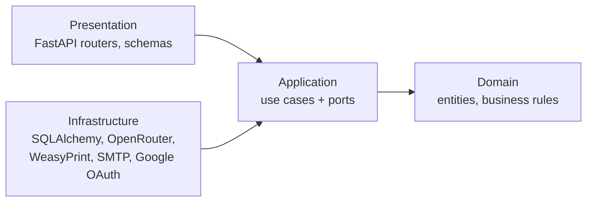
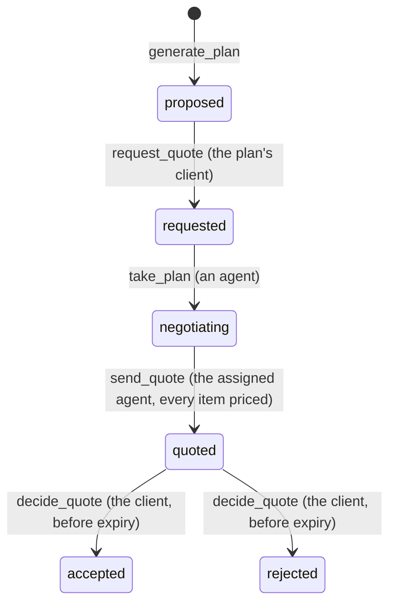
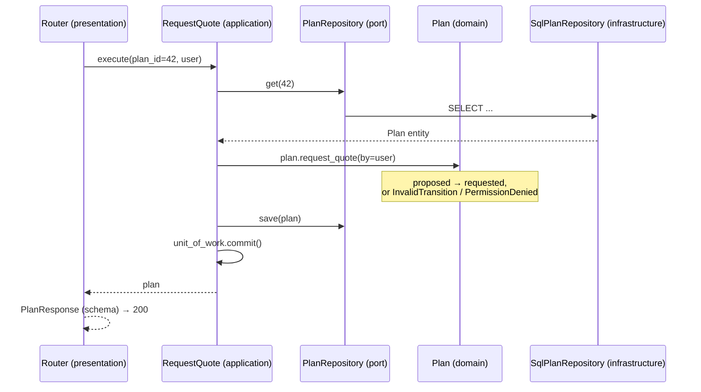

# Novoya backend architecture

This page explains how the backend in `apps/api` is built: its layers, where each piece of code goes, and the rules that keep it clean. The product, the data model and the API list are in [ARCHITECTURE.md](ARCHITECTURE.md).

## 1. Clean Architecture in one rule

The backend follows Clean Architecture. The code is split into four layers, and **source code dependencies only point inward**:



The inner layers hold what Novoya *is*: a travel agency that builds plans from partner offers and sends negotiated quotes. The outer layers hold *how* it is delivered today: a web API, PostgreSQL, an LLM from OpenRouter, a PDF library, an SMTP server. Those tools can change without touching the business rules.

How the inner layers use outer tools without importing them: the application layer declares **ports** (interfaces) for what it needs, such as "save a plan" or "render a quote". The infrastructure layer provides **adapters** that implement those ports with real tools. The **composition root** plugs adapters into use cases when a request arrives.

| Layer | Holds | May import |
|---|---|---|
| Domain | Entities, value objects, business rules, domain errors | The domain and the Python standard library only |
| Application | Use cases (one per user action) and ports | Domain |
| Infrastructure | Adapters: database, LLM, PDF, email, Google sign-in | Application, domain, config |
| Presentation | FastAPI routers, Pydantic schemas, the composition root | Application, domain; infrastructure only in the composition root |

`tests/test_architecture.py` checks these rules on every import, in CI (section 8).

## 2. Folders

```
apps/api/
  src/novoya_api/
    main.py                     creates the FastAPI app, includes the routers
    config.py                   settings from NOVOYA_* environment variables
    openapi.py                  prints openapi.json for the frontend

    domain/
      entities/                 User, Partner, Offer, Wish, Plan, PlanItem, Quote
      value_objects/            Money, DateRange, Tag, Destination, Panel
      errors.py                 DomainError, NotFound, InvalidTransition, PermissionDenied

    application/
      ports/                    interfaces the use cases need
        health.py               DatabaseProbe (done)
      use_cases/                one module per user action
        check_database.py       CheckDatabase (done)

    infrastructure/
      db/
        base.py                 SQLAlchemy declarative Base
        session.py              engine and session per request
        models/                 ORM tables, one file per table
        repositories/           repository ports implemented with SQLAlchemy
        probe.py                DatabaseProbe implemented with SELECT 1 (done)
        seed/                   partners and offers for local development
      llm/                      OpenRouter client, tool-calling orchestrator, tools/, prompts/
      pdf/                      QuoteRenderer with Jinja2 + WeasyPrint, templates/
      email/                    QuoteNotifier over SMTP, templates/
      auth/                     IdentityProvider with Google OAuth

    presentation/http/
      routers/                  endpoints, one module per resource
      schemas/                  Pydantic request and response models
      dependencies.py           composition root: builds use cases with their adapters

  tests/                        see section 7
  alembic/versions/             database migrations
```

Every package's `__init__.py` lists the files planned in it and the issue that adds each one.

## 3. Domain layer

The domain is plain Python: dataclasses and functions. It knows nothing about HTTP, SQL or LLMs, so its rules can be read and tested on their own.

### Entities

| Entity | Main fields | Rules it owns |
|---|---|---|
| `User` | id, email, name, role (`client`, `agent`), locale (`en`, `fr`) | Only agents may handle quotes |
| `Partner` | id, name, kind, country, city, contacts, active | An inactive partner's offers are never used |
| `Offer` | id, partner_id, kind, title, description, destination, tags, person limits, availability, featured, active | Fits a number of travellers and a date range or not. **No price** |
| `Wish` | id, user_id, text, destination, status, panel, selected tags, budget, travellers, dates | Status: `draft` → `not_covered` or `panel_shown` → `answered` → `planned` |
| `Plan` | id, wish_id, status, items, based_on_preferences, assigned agent | The status machine below |
| `PlanItem` | offer_id, day, quantity, note, negotiated price, removed | A price is set only while the plan is `negotiating` |
| `Quote` | id, number, plan_id, total, currency, locale, valid until, decision | Total = sum of the prices of the items not removed. Valid 7 days. Answered once, before it expires |

### The plan status machine



The allowed moves live in `Plan`'s methods, for example `plan.request_quote(by=user)`. Any other move raises `InvalidTransition`. No other layer changes a status directly.

### Value objects

Small immutable values compared by content: `Money` (amount and `EUR`), `DateRange` (start before end), `Tag` (section and tag), `Destination` (country and city), `Panel` (the sections and tags shown to the client).

### Errors

`domain/errors.py` defines what can go wrong in business terms:

| Error | Meaning |
|---|---|
| `NotFound` | The object does not exist, or the caller may not see it |
| `PermissionDenied` | The caller exists but may not do this (a client calling an agent action) |
| `InvalidTransition` | A status change the rules forbid, such as quoting a plan twice |

The domain never knows about HTTP status codes. The presentation layer translates these errors (section 6).

## 4. Application layer

### Use cases

One use case per thing a user can do. A use case loads entities through ports, asks the entities to apply their rules, saves the result through ports, and returns a plain result. It never imports a framework.

| Use case | Who | Endpoint | Ports it uses | Issue |
|---|---|---|---|---|
| `SignIn` | anyone | `/auth/google/callback` | IdentityProvider, UserRepository | #15, #49 |
| `ListDestinations` | client | `GET /destinations` | OfferRepository | #21 |
| `SendWish` | client | `POST /wishes` | WishRepository, OfferRepository, PanelBuilder | #23, #25 |
| `AnswerPanel` + `GeneratePlan` | client | `POST /wishes/{id}/answers` | WishRepository, OfferRepository, PlanGenerator, PlanRepository | #28, #29 |
| `RequestQuote` | client | `POST /plans/{id}/request-quote` | PlanRepository | #50 |
| `ListQuoteQueue` | agent | `GET /agent/plans` | PlanRepository | #51 |
| `TakePlan` | agent | `POST /agent/plans/{id}/take` | PlanRepository | #51 |
| `SetItemPrice` | agent | `PATCH /agent/plans/{id}/items/{item_id}` | PlanRepository | #51 |
| `SendQuote` | agent | `POST /agent/plans/{id}/quote` | PlanRepository, QuoteRepository, QuoteRenderer, QuoteNotifier | #52, #53 |
| `DecideQuote` | client | `POST /quotes/{id}/accept`, `/reject` | QuoteRepository, PlanRepository | #54 |
| `DeleteAccount` | client | `DELETE /me` | UserRepository, QuoteRenderer (delete files) | #46 |
| `ManageCatalog` | agent | `/admin/partners`, `/admin/offers` | PartnerRepository, OfferRepository | #18 |
| `CheckDatabase` | anyone | `GET /health/db` | DatabaseProbe | done |

### Ports

Ports are `typing.Protocol` interfaces in `application/ports/`. They describe what a use case needs in business words, not how it is done.

| Port | What it offers | Adapter (infrastructure) |
|---|---|---|
| `UserRepository`, `PartnerRepository`, `OfferRepository`, `WishRepository`, `PlanRepository`, `QuoteRepository` | Load and save entities, and searches such as `OfferRepository.search(destination, tags, persons, dates)` | `db/repositories/` with SQLAlchemy |
| `UnitOfWork` | `commit()` and `rollback()`: one use case is one transaction | `db/` with the request's session |
| `PanelBuilder` | Build a `Panel` for a wish from the offers at its destination | `llm/` with OpenRouter |
| `PlanGenerator` | Propose plan items for a wish from the offers it may use | `llm/` with OpenRouter and the travel tools |
| `QuoteRenderer` | Turn a quote into a PDF in the client's language | `pdf/` with Jinja2 + WeasyPrint |
| `QuoteNotifier` | Tell the client their quote is ready | `email/` over SMTP |
| `IdentityProvider` | Turn a Google sign-in into an email and a name | `auth/` with Google OAuth |
| `DatabaseProbe` | Check the database answers | `db/probe.py` (done) |

### The LLM stays outside the rules

The LLM is just another adapter behind `PanelBuilder` and `PlanGenerator`. It proposes; the use case decides:

- `GeneratePlan` receives the items the LLM proposes and keeps only those whose `offer_id` is a real, active offer that fits the travellers and dates. This check is a business rule, so it lives in the domain and runs on every plan, whatever the model returns.
- If the model fails or returns invalid JSON twice, the adapter raises, and the use case falls back (for example a panel built directly from the offers' tags).
- Changing the model (`NOVOYA_LLM_MODEL`) or the provider only touches `infrastructure/llm/`.

## 5. Infrastructure layer

Every tool Novoya uses lives here, and only here:

| Folder | Implements | Tool |
|---|---|---|
| `db/repositories/` | the repositories, `UnitOfWork` | SQLAlchemy 2 (async) + PostgreSQL |
| `db/models/` | the tables (Alembic reads them) | SQLAlchemy ORM |
| `llm/` | `PanelBuilder`, `PlanGenerator` | OpenRouter through the `openai` SDK, tool calling |
| `llm/tools/` | `covered_destinations()`, `search_offers()` for the model | read the catalog through `OfferRepository` |
| `pdf/` | `QuoteRenderer` | Jinja2 + WeasyPrint |
| `email/` | `QuoteNotifier` | SMTP (Mailpit locally) |
| `auth/` | `IdentityProvider` | Google OAuth, `openid email profile` |

ORM models are not entities. A repository maps rows to entities when it loads and entities to rows when it saves, so no SQLAlchemy object ever leaves `infrastructure/db/`.

## 6. Presentation layer

Today the only way in is HTTP with FastAPI.

- **Routers** stay thin: parse the request into a schema, call one use case, turn the result into a response schema.
- **Schemas** are the Pydantic models of the HTTP API. FastAPI builds `openapi.json` from them, and the frontend generates its client from that file. Schemas are not entities: the API can change shape without changing the domain.
- **`dependencies.py` is the composition root.** It builds each use case with its adapters as a FastAPI dependency. Tests replace these dependencies with fakes. It also holds `current_user` and `require_agent`.
- **Domain errors become HTTP codes** in one exception handler:

| Domain error | HTTP |
|---|---|
| `NotFound` | 404 |
| `PermissionDenied` | 403 |
| `InvalidTransition` | 409 |
| Invalid input (Pydantic) | 422 |

"Destination not covered" is not an error: it is a normal result of `SendWish`, returned with status 200 and `not_covered`.

## 7. One request, end to end

The client asks for a quote (`POST /plans/42/request-quote`, #50):



The router never sees SQL, the use case never sees HTTP, and the rule "only the plan's client, only from `proposed`" exists in exactly one place: `Plan.request_quote`.

### The example that already runs

`GET /health/db` goes through every layer and is the model to copy:

| Layer | File | Role |
|---|---|---|
| Application, port | `application/ports/health.py` | `DatabaseProbe` with `ping()` |
| Application, use case | `application/use_cases/check_database.py` | `CheckDatabase`: returns `True` if the probe answers |
| Infrastructure | `infrastructure/db/probe.py` | `SqlDatabaseProbe`: `SELECT 1` |
| Presentation | `presentation/http/dependencies.py` | builds `CheckDatabase(SqlDatabaseProbe(session))` |
| Presentation | `presentation/http/routers/health.py` | calls the use case, answers 200 or 503 |

## 8. Tests

The layers make each kind of test simple:

| What | How | Needs |
|---|---|---|
| Domain rules (status machine, totals, validity) | Plain unit tests on entities | Nothing |
| Use cases | Call the use case with fake ports (in-memory repositories, a fake LLM) | Nothing |
| Adapters | Run the repositories against a real PostgreSQL | The Postgres service in CI |
| HTTP | `httpx` against the app, with `app.dependency_overrides` replacing adapters | Nothing |
| Architecture | `tests/test_architecture.py` | Nothing |

CI never calls the real LLM, SMTP server or Google.

`tests/test_check_database.py` (a use case with a fake port) and `tests/test_health.py` (the HTTP layer with an overridden dependency) are the examples to copy.

### The architecture test

`tests/test_architecture.py` reads every import in `src/novoya_api` and fails if:

- the domain imports anything outside the domain, or any framework (FastAPI, SQLAlchemy, Pydantic, `openai`, WeasyPrint, Jinja2...);
- the application imports infrastructure, presentation or any framework;
- infrastructure imports presentation;
- presentation imports infrastructure anywhere except the composition root.

A last test plants a forbidden import in a temporary file and checks that the rule catches it, so the guard cannot silently stop working.

## 9. Adding a feature, step by step

Example: "ask for a quote" (#50).

1. **Domain**: add `Plan.request_quote(by)` with its rule, and test it.
2. **Application**: add the port method you need (`PlanRepository.get`, `save`) and the use case `use_cases/request_quote.py`. Test it with a fake repository.
3. **Infrastructure**: implement the port in `db/repositories/plans.py`, plus a model and an Alembic migration if a table changes.
4. **Presentation**: add the response schema, the route in `routers/plans.py`, and the wiring in `dependencies.py`.
5. Regenerate `openapi.json` (`uv run python -m novoya_api.openapi > openapi.json`) and run `uv run ruff check .`, `uv run pytest`.

If step 2 needs to import SQLAlchemy or FastAPI, the code belongs in another layer: the architecture test will say so.
