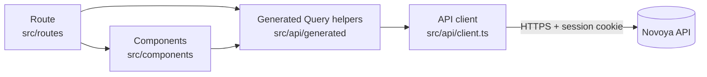

# Novoya frontend architecture

This page explains how the web app in `apps/web` is built, where code goes, and the rules that keep it clean. The backend is described in [ARCHITECTURE.md](ARCHITECTURE.md).

## 1. Role of the frontend

The frontend is Novoya's user interface, and nothing more. All business rules live in the backend's domain and use cases: coverage, which offers can go in a plan, plan statuses, prices, quote totals, who may see what.

The frontend:

- shows pages to two kinds of users: clients and travel agents;
- sends what the user does to the API;
- shows what the API returns, in English or French.

It never decides a business rule on its own. For example, it hides the "Ask for a quote" button when a plan is not `proposed`, but the backend is the one that refuses the request. The button is a convenience, not a security check.

## 2. Stack

| Need | Tool | Why |
|---|---|---|
| UI | React 19 + TypeScript | Typed components, the team knows it |
| Build and dev server | Vite | Fast reload, simple config |
| Pages and URLs | TanStack Router, file-based | Each file in `src/routes/` is a page; URLs and params are typed |
| Data from the API | TanStack Query | Caching, loading and error states, refetching, no global store needed |
| Forms | TanStack Form | Typed fields and validation (wish, panel, prices) |
| API client | `@hey-api/openapi-ts` | Generates typed functions and Query helpers from the backend's `openapi.json` |
| Tests | Vitest + Testing Library | Test components the way a user sees them |
| Lint | oxlint | Fast, includes the React hooks rules |

## 3. How a page gets its data



1. A **route** (page) reads its URL params and calls a generated query, for example `getPlanOptions({ path: { id } })`.
2. **TanStack Query** fetches the data, caches it, and gives the page `data`, `isPending` and `error`.
3. The route passes the data to **components**, which only display it and report user actions.
4. A user action calls a generated **mutation**, for example `requestQuoteMutation()`. On success, the related queries are invalidated so the page shows fresh data.

The API client in `src/api/client.ts` sets the base URL (`VITE_API_URL`) and `credentials: 'include'`, so the session cookie set by Google sign-in goes with every request.

### The contract with the backend

The frontend never writes API types by hand:

1. The backend changes an endpoint and commits a new `apps/api/openapi.json`.
2. `pnpm gen` regenerates `src/api/generated/`. `dev`, `build`, `typecheck` and `test` run it first.
3. If the API changed in a breaking way, `pnpm typecheck` fails and points at every place the frontend must follow.

## 4. Folders

```
apps/web/src/
  main.tsx               entry: mounts React with the Query and Router providers
  router.tsx             creates the router and the QueryClient
  index.css              design tokens (colours, fonts) and base styles, light and dark
  api/
    client.ts            configures the generated client (base URL, cookies)
    generated/           created by pnpm gen, never edited, not committed
  routes/                pages, one file per URL (TanStack file-based routing)
    __root.tsx           layout shared by every page: header, main, devtools
    index.tsx            home page
    wishes/  plans/  quotes/  agent/  admin/  settings/
  components/            pieces of UI used by pages
    ui/                  generic pieces: Button, Input, Field, Card, Badge
    panel/               PanelSection, TagPicker: render the panel JSON from the API
    plan/  quote/  agent/
  hooks/                 shared React hooks, for example useCurrentUser, useLocale
  lib/                   plain helpers with no React: formatMoney, formatDate
  i18n/                  English and French texts
  test/                  test setup
```

### What goes where

| Folder | Contains | Must not contain |
|---|---|---|
| `routes/` | One page per file: reads the URL, loads data, handles the page's actions, lays out components | Reusable UI, `fetch` calls |
| `components/` | Display and interaction. Data comes in through props; actions go out through callbacks | Data loading, route logic, imports from `routes/` |
| `components/ui/` | Generic, project-wide pieces with no Novoya knowledge | Anything about wishes, plans or quotes |
| `hooks/` | Logic shared by several pages | JSX |
| `lib/` | Pure functions, easy to test | React, API calls |
| `api/generated/` | Generated code | Hand edits: they are lost at the next `pnpm gen` |

## 5. Dependency rules

The same idea as the backend: dependencies point one way.

```
routes  ──►  components  ──►  components/ui
  │              │
  └──►  hooks, lib, i18n, api/generated  ◄──┘
```

- `routes/` may import everything below it.
- `components/` never import from `routes/`.
- `components/ui/` imports nothing from the other component folders.
- `lib/` imports nothing from React or the API.
- Only the generated client talks to the API. No `fetch()` anywhere else.
- No business rules: no price maths, no status decisions. Show what the API says.

## 6. Pages

Client pages:

| URL | File | What it does | Issues |
|---|---|---|---|
| `/login` | `routes/login.tsx` | "Sign in with Google" button | #16 |
| `/` | `routes/index.tsx` | Home, with the wish input | #24 |
| `/wishes/$wishId` | `routes/wishes/$wishId.tsx` | The panel: tags, then budget, travellers and dates. Or the "not covered" message with suggestions | #24, #26, #27 |
| `/plans/$planId` | `routes/plans/$planId.tsx` | The proposed plan day by day, without prices or partner names; "Ask for a quote" | #31, #50 |
| `/quotes/$quoteId` | `routes/quotes/$quoteId.tsx` | The quote: total, validity, PDF download, accept or reject. The email button opens this page | #54 |
| `/settings` | `routes/settings/index.tsx` | What Novoya stores; delete my account | #46 |
| `/privacy` | `routes/privacy.tsx` | The privacy policy | #45 |

Agent pages (role `agent` only):

| URL | File | What it does | Issues |
|---|---|---|---|
| `/agent` | `routes/agent/index.tsx` | The quote queue | #51 |
| `/agent/plans/$planId` | `routes/agent/plans/$planId.tsx` | Take the plan, enter a price per item (partner names and contacts shown), running total against the budget, send the quote | #51, #52 |
| `/admin/partners`, `/admin/offers` | `routes/admin/` | Manage the catalog | #19 (stretch) |

## 7. Sign-in and roles

- Google sign-in happens on the backend. The frontend only links to `/auth/google/login`; the backend sets a session cookie and redirects back.
- `GET /me` returns the user, their role and their locale. `useCurrentUser()` reads it with TanStack Query, so every page shares one cached answer.
- Protected pages use the router's `beforeLoad`:
  - pages for signed-in users redirect to `/login` when `/me` answers 401, and come back to the same URL after sign-in. This is how the email's "Log in to see my quote" button lands on the right quote;
  - `routes/agent/route.tsx` and `routes/admin/route.tsx` are layout routes that redirect clients away.
- These redirects are for comfort only. The backend answers 403 to a client calling an agent endpoint, whatever the frontend does.

## 8. English and French

- Texts live in `src/i18n/en.ts` and `src/i18n/fr.ts`, as plain typed objects with the same keys. TypeScript fails if a key is missing in one language.
- `useLocale()` takes the locale from `/me` (or the browser before sign-in) and returns a `t()` function.
- Dates and prices go through `lib/formatDate` and `lib/formatMoney`, which use `Intl` with the current locale. Prices are always in euros.
- Text that comes from the API (offer titles, the panel) is already in the right language: the backend sends it.

## 9. Styling

- `index.css` defines the design tokens as CSS variables (`--text`, `--bg`, `--ok`, `--error`...) for light and dark mode.
- Components use these variables, never raw colours, so a change of palette happens in one place.
- Every page must work at phone width.

## 10. Tests

- Components and pages are tested with Vitest and Testing Library, by what the user sees: text, buttons, roles.
- The API is faked by mocking `fetch`; the tests never call the real backend. `components/ApiStatus.test.tsx` is the example to copy.
- Pure helpers in `lib/` get plain unit tests.

## 11. Adding a page, step by step

Example: the plan page (#31).

1. Make sure the backend endpoint exists and `openapi.json` is committed, then run `pnpm gen`.
2. Create `src/routes/plans/$planId.tsx` with `createFileRoute`. The router plugin adds it to the route tree.
3. Load the data with the generated query: `useQuery(getPlanOptions({ path: { id: planId } }))`. Handle `isPending` and `error`.
4. Put the display in `components/plan/` (`PlanDay`, `PlanItem`), with data in props.
5. Put every text in `i18n/en.ts` and `i18n/fr.ts`.
6. Write a test for the component with a mocked `fetch`.
7. Run `pnpm lint`, `pnpm typecheck`, `pnpm test` and `pnpm build`, then open the pull request.
